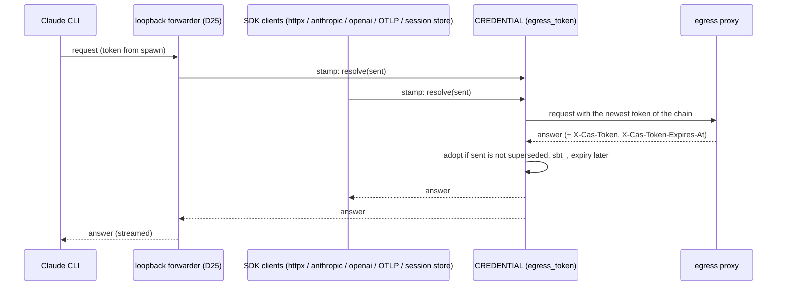

# P1-SDK: the SDK's calls through the CAS egress proxy

- Status: draft (2026-10-26)
- Request: make every call the SDK makes in harness mode match a route the CAS egress proxy serves, and run the SDK the way old CAS provisions stage sandboxes, as the user resolved:
  - the AgentOS agent-document URL (R2);
  - guardrail checks through the proxy's `POST /guardrails/v1/check` instead of SRS (R4);
  - no SRS policy fetch (R5), no org RAI policy fetch and no `rai_policy_id` (Q9): the agent gateway resolves policies;
  - adoption of reissued sandbox tokens by every client that calls the egress proxy, the Claude CLI and its MCP servers included: once the SDK has seen a reissue, every later egress request from any client carries the newest token (R6; user, 2026-10-26);
  - OTLP to `telemetry_url=http://egress/otlp` with exports under the proxy's 1 MiB limit (Q3);
  - the dashboard events sink deleted (Q4);
  - the HTTP session store through the proxy, with its own URL setting (R7, Q13);
  - MCP servers addressed by name: `{COMPUTERAGENT_MCP_URL}/{name}`, no query, with `COMPUTERAGENT_MCP_URL=http://egress/mcp/v1`; `{name}` is the binding's `tool_name` as is, which AgentOS guarantees is printable ASCII (Q1, Q15, gateway decisions and user decision on OQ4, 2026-10-26).
  - the AgentOS agent document as old-CAS #164 returns it: the model from `llm.config.model` (the gateway agent's kong model), MCP servers from `mcp.servers[]`, no native/generic model-gateway handling (C1);
  - the Lyzr key picked up every turn, since old CAS hands each turn a fresh sandbox token (C2);
  - the app server in the stage image: the harness REST API `/v1/*` on Lambda MicroVM (C3), the same API inside relay envelope v1 on `/invocations` plus `GET /ping` on AgentCore (C4) (old-CAS overview G14, G15).

  The direct-call code paths stay in the code but are not used in this setup (Q7). No egress-route question is open; Q16–Q18 (app server, events, resume) are open for the SDK team (§3). The agent gateway's part is the directive `lyzr-computer-agent-service/.claude/plans/p1-agw-directives-sdk-egress.md` (D1 rejected, D2 accepted ASCII only, D3–D5); old CAS's part is `lyzr-computer-agent-service/.claude/plans/p1-old-cas-directives-sdk-egress.md` (O1, O3–O5).
- Source: user resolutions R1–R7 and the Q1, Q3, Q4, Q7, Q8, Q9, Q10, Q11, Q13, Q14, Q15 answers (2026-10-26, relayed by Main); SDK egress audit rows 1–15; proxy plan `lyzr-computer-agent-service/.claude/plans/p1-proxy-9-sdk-routes.md` (D1–D21, X1–X11); gateway directive `lyzr-computer-agent-service/.claude/plans/p1-agw-directives-sdk-egress.md`; the old-CAS SDK hand-off (app server, per-turn key, reissue, kong model, agent-document changes; merged into this plan 2026-10-27, its file deleted); old-CAS overview `computeragent-enterprise/.claude/plans/p1-old-cas-proxy-integration.md` (G14, G15, G17, G18, Q17) and PR 6 plan `…-6-agent-model-settings.md` (#164, the agent document); CAS contracts `computeragent-enterprise/packages/protocol/src/harness-rest.ts`, `sse-events.ts`, `packages/harness-server/src/routes/*`, `packages/runtime-agentcore/src/relay.ts`, `packages/runtime-lambda-microvm/src/lambda-microvm-boot.ts`; gateway contract `agent-gateway-v1` §7.1 model, §7.2 MCP (`/tmp/agw-contract/agent-gateway-v1.md:102-107`), §7.3 (`:108-133`), OTLP (`:147, 207`), §8 MCP config (`:184-191`); AgentOS `packages/agentos-server/src/mcp-binding.ts`, `routes/agents.ts:733-797`; old CAS `packages/computeragent-server/src/session-store-route.ts`, `index.ts`.
- Task id: none (slug `p1-sdk-egress-routes`; the proxy side is P1-PROXY plan 9).
- Branch: `feat/p1-sdk-egress-routes` from `cas-phase-1` (commit `9ce8961`, release 0.6.0) → PR into `cas-phase-1`. Release 0.7.0 (breaking: settings, public exports and fail-open behaviour change).
- The only SDK plan: the old-CAS SDK hand-off was merged here on 2026-10-27 (C1–C4, phases 5 and 9–12) and its file deleted; the old-CAS plans point here.
- Phases and files (each phase counts the files it touches; the plan file is committed with phase 1): 1: 4, 2: 23, 3: 28, 4: 8, 5: 17, 6: 9, 7: 10, 8: 7, 9: 13, 10: 8, 11: 13, 12: 5.

## 1. Acceptance criteria
- R2: with `COMPUTERAGENT_BASE_URL=http://egress/computer-agent-api/agentos/api` the agent is read from exactly `GET http://egress/computer-agent-api/agentos/api/v1/agents/{id}` (one `/agentos/api`) → `test_egress_base_builds_single_prefix`, phase 1.
- Q4: no `AgentOSHttpSink`, no `events_url`, no `COMPUTERAGENT_EVENTS_URL`; no request to `/events` → `test_harness_telemetry.py::test_no_events_sink`, `test_settings.py::test_events_url_is_unknown`, phase 2.
- R4: the user-message check sends `{"op":"input","subject":{"text":…}}` and each tool call sends `{"op":"tool-input","subject":{"toolCalls":[{"id","name","arguments"}]}}` to `POST {guardrails_url}/v1/check` with `x-api-key`; verdicts map as D5; no verdict as D6 → `tests/test_guardrails_client.py`, `test_srs_input.py`, `test_srs_gate.py`, phase 3.
- Q10: `toolCalls[].id` is the engine's own tool-use id on every path (Claude CLI `can_use_tool` and PreToolUse hook, gitagent Anthropic and OpenAI loops); the SDK never generates one; a tool call that reaches the gate without an id is denied without a request (D7) → `test_check_tool_call`, `test_srs_gate.py::test_tool_call_without_id_is_denied`, `test_policy_authorizer.py::test_call_id_reaches_policy_input`, `test_engine_policy_hook.py::test_hook_passes_tool_use_id`, phase 3.
- R4: no call to `/v1/rai/inference` or `/v1/guardrails/evaluate-tool-call`; `COMPUTERAGENT_SRS_URL` gone, `COMPUTERAGENT_GUARDRAILS_URL` required → `test_never_calls_srs_paths`, `test_settings.py`, phase 3.
- Q9: no request to `/v3/org/rai-policy`; no `agent_api_url` / `COMPUTERAGENT_AGENT_API_URL`; the agent document's `rai_policy_id` is not read → `test_never_calls_org_policy`, `test_settings.py`, `test_agentos_agent_resolve.py::test_rai_policy_id_ignored`, phase 3.
- R5: no `GET …/rai/policies/{id}`; `SrsPolicyEngine` and `srs_authorizer_from_env` removed → `test_policy_exports.py`, phase 4.
- R6: once any answer to an egress request carries a valid reissue (`X-Cas-Token`, `X-Cas-Token-Expires-At`; D3), every later egress request from every client carries the newest token of that chain: the SDK's own httpx clients (owned or injected), the in-process `anthropic`/`openai` clients, the OTLP exporters (phase 6), the session store (phase 7), and the Claude CLI's model and MCP requests, which go through the SDK's loopback forwarder (D25), also within a running CLI turn; `Settings.api_key()` returns the newest token, also for an explicit `api_key=`; a late reissue never replaces a newer per-turn token; headers and tokens never reach logs → `tests/test_egress_token.py`, `tests/test_egress_forwarder.py`, phase 5.
- Q3: no OTLP request body exceeds 1 MiB (960 KiB budget); exports are split, never truncated mid-record; a single record over the budget is dropped with a count-only WARN → `tests/test_otlp_size.py`, phase 6.
- R7/Q13 (review D15): with `COMPUTERAGENT_SESSION_STORE_URL=http://egress/computer-agent-api`, an `http` store uses that base (over any descriptor `base_url`/`baseUrl`) and sends only `x-api-key` = the newest sandbox token (`Settings.api_key()`, D2) on load and append; it never sends `x-ca-session-store-token`, never calls `/v1/auth/token`, and needs no `token` option → `test_session_store_http.py`, `test_settings.py`, phase 7.
- Q14: an invalid session-store descriptor's error names only its type and keys, never a value → `test_session_store_wiring.py::test_descriptor_error_never_echoes_values`, phase 7.
- Q1/Q15 (gateway decisions 2026-10-26): each engine MCP server URL is `{mcp_url}/{name}` with **no query**: `{name}` = the binding's `tool_name` as is, percent-encoded as one path segment (`/` → `%2F`, space → `%20`). No name check in the SDK: AgentOS guarantees the rule (old-CAS directive O5) (D17) → `tests/test_mcp.py` (updated and new cases), phase 8.
- C1 (old-CAS #164): the model is the document's `llm.config.model` (gitagent `openai:claude-sonnet-4-5`, Claude `claude-sonnet-4-5`); `llm` null, absent or without a model → no `model` option (the image's own model); MCP bindings come only from `mcp.servers[]`, `mcp: null` → none; `guardrails`, `rai_policy_id`, `model`, `mcp_servers`, `mcp_mode`, `model_gateway`, `modelGatewayId` are never read and never refuse the agent → `test_agentos_agent_resolve.py::test_model_from_llm_config`, `test_null_llm_uses_the_image_model`, `test_legacy_fields_are_ignored`, `test_guardrails_section_ignored`, `test_mcp.py::test_parses_mcp_section`, phase 9.
- C2: with `LYZR_API_KEY` changed between two turns, turn 2's engine env (`ANTHROPIC_API_KEY`, `OPENAI_API_KEY`, `LYZR_API_KEY`) and every bound MCP server's `x-api-key` carry the new key → `tests/test_turn_key.py`, phase 10.
- C3: the app on `:8080` answers the Lambda MicroVM lifecycle hooks, `GET /v1/health` and CAS's harness REST routes with its bodies and `sse-events.ts` events; a message's `credential` becomes that turn's key; every turn's stream ends with `ca_session_ended` → `tests/test_server_app.py`, `test_server_events.py`, `test_server_fs.py`, phase 11.
- C4: `GET /ping` reports `Healthy`/`HealthyBusy`; `POST /invocations` takes relay envelope v1, dispatches to the C3 routes in-process and always answers HTTP 200 (SSE head frame `: ca-relay {…}`, JSON envelope otherwise, `status: 400` for a malformed envelope) → `tests/test_server_relay.py`, phase 12.

## 2. Research

### Current state (`9ce8961`)
- Settings: `COMPUTERAGENT_BASE_URL`, `LYZR_API_KEY`, `COMPUTERAGENT_LLM_URL`, `…_MCP_URL`, `…_AGENT_API_URL`, `…_SRS_URL`, `…_TELEMETRY_URL`, `…_EVENTS_URL`, `…_GAP_DIR` (`src/computeragent/harness/settings.py:28-37`); required URLs `("llm_url", "mcp_url", "agent_api_url", "srs_url")` (`:41`), optional `("telemetry_url", "events_url")` (`:45`); `api_key()` re-read per call (`:90-98`). Documented egress values `README.md:16-22`, `docs/USING_THE_SDK.md:52-56, 79-83`; request table `USING_THE_SDK.md:120-130` (`:129` says only `POST /v1/traces, /v1/metrics, /v1/logs` for `telemetry_url`).
- Agent document: `api_base()` (`harness/agentos_agent.py:91-128`) maps `…/agentos/api` → `…/agentos/api/v1` (`:115-116`); lookup `f"{api_base(base_url)}/agents/{agent_id}"` with `x-api-key` (`:239-246`). Already a single prefix (proxy plan X1). `rai_policy_id` field `:84`, parsed `:272-287`. Model: `model_of` (`:131-148`) takes `model_gateway.binding.externalModelId`, then `.binding.model`, then the top-level `model`; `_require_supported` refuses a non-`native` `model_gateway` (`:177-184`); `_require_consistent_gateway` refuses `modelGatewayId` without `model_gateway` (`:193-209`); `ResolvedAgent.gateway_type`, `gateway_base_url`, `gateway_completions_url`, `has_native_gateway`, `mcp_mode` (`:67-88`, filled `:274-289`). gitagent gets `openai:` only when `has_native_gateway` (`gateway_envs.py:43-58`). Fixture `tests/fixtures/agent_doc.json` has the pre-#164 shape (`model`, `modelGatewayId`, `model_gateway`, `rai_policy_id`, `mcp_servers`, `mcp_mode`, `:8-37`).
- Model clients: `ANTHROPIC_BASE_URL`, `GITAGENT_MODEL_BASE_URL`, `GITCLAW_MODEL_BASE_URL` = `llm_url` (`harness/gateway_envs.py:61-88`); in-process `AsyncAnthropic(api_key, base_url)` (`engines/git_agent.py:288-299`), `AsyncOpenAI(base_url, api_key)` (`:405-417`); the Claude CLI is a subprocess with `options.env` (`engines/claude_agent.py:130-134`; `claude_agent_sdk/_internal/transport/subprocess_cli.py:812-818, 862`). Envs, keys included, are built once (`harness/__init__.py:331-334`) and reused every turn (`coordinator.py:371`) while the engine session starts per turn (`coordinator.py:451`); bound MCP servers carry an `x-api-key` fixed at construction (`harness/__init__.py:377-382`, `mcp.py:113`) and are merged into the manifest once at boot (`coordinator.py:215-225`). `Settings.api_key()` reads `os.environ` at each call unless `api_key=` was passed (`settings.py:90-98, 130`).
- Telemetry: `build_pipeline(telemetry_url, events_url, api_key)` (`harness/telemetry.py:25-55`): `OtelSink(exporter="otlp-http", endpoint=telemetry_url, headers={"x-api-key": api_key()})`, the key read once (`:42-49`); events `AgentOSHttpSink(url=f"{events_url}/events")` (`:51-54`). `OtelSink` appends `/v1/{signal}` (`telemetry/sinks/otel.py:1399-1411`), `BatchSpanProcessor(span_exporter)` with defaults (`:1489`), `PeriodicExportingMetricReader(..., export_interval_millis=5000)` (`:1520`), `BatchLogRecordProcessor(log_exporter)` (`:1538`); legacy `AGENTOS_OTEL_URL` + `cak_` Bearer (`:616-625`). OTel defaults: batch of up to 512 per export [INFERENCE: OTel Python SDK default `max_export_batch_size`]; encoders in `opentelemetry-exporter-otlp-proto-common` 1.42.1 (`trace_encoder`, `_log_encoder`, `metrics_encoder`).
- Events sink: `telemetry/sinks/agentos_http.py` (`DEFAULT_MAX_BUFFER_BYTES = 4_000_000` `:55-57`, POST `:171-174`); exported lazily (`telemetry/sinks/__init__.py:10, 20-23`); auto-attached on the drop-in path from `agentos.ingest_url()` (`telemetry/config.py:53, 150-160`); used by `examples/with_agentos.py`, `examples/multi_sink.py:29, 45`, `examples/e2e/run_live_demo.py:28, 52, 152`; tests `tests/test_sink_agentos_http.py`, `tests/test_harness_telemetry.py:4, 20, 55-119`, `tests/test_optional_extras.py:49-77`, `tests/test_settings.py:47, 65, 128, 216-234`, `tests/conftest.py:17`; docs `README.md:22`, `docs/ARCHITECTURE.md:19, 39, 61, 110`, `docs/USING_THE_SDK.md:117, 130, 160, 513, 640`, `examples/e2e/live_agent_run.py:18, 116`, `examples/e2e/README.md:143`, `examples/e2e/destinations.md:111`; comment `harness/coordinator.py:385`.
- Guardrails:
  - `check_input`: `POST {srs}/v1/rai/inference` stage `llm_input`, body `policy_ids`, `input_text`, `principal_id`; reads `blocked`, `processed_text`, `block_reason`, `blocked_by_policy_id`, `warnings`, `redaction_map` (`policy/srs_client.py:212-251`).
  - `check_tool_content`: same path, stage `llm_output`, tool-call `messages`, `use_cache: false`, skipped when no string argument (`:254-320`).
  - `check_tool_call`: `POST {srs}/v1/guardrails/evaluate-tool-call`, body `policy_ids`, `tool_name`, `raw_tool_name`, `tool_args`, `principal_id`, `bundle_id`, `bundle_name`; only `allowed: true` allows (`:323-367`).
  - Gate: `SrsToolGate.evaluate` runs both checks with `call_id=None` (`policy/srs_gate.py:109-160`); unresolved turn → deny (`:111-118`); no policy ids → allow without a call (`:120-122`); no verdict → org `fail_open` except 422 (`:186-200`). Input: `check_user_message` per text slot; no verdict blocks only when `fail_open is False` (`policy/srs_input.py:110-175`).
  - Turn: `SrsTurnGuard.resolve_turn` fetches `GET {agent_api_url}/v3/org/rai-policy` each turn (`harness/guardrails.py:40-110`; `policy/org_policy.py:87-161`) and combines it with `rai_policy_id` (`harness/__init__.py:385-417`); `TurnPolicy`, `build_turn_policy`, `TURN_UNRESOLVED_REASON` (`srs_gate.py:49-75`).
- Standalone SRS: `SrsPolicyEngine` loads `GET {srs}/rai/policies/{id}` (`policy/srs.py:162-168`), `srs_authorizer_from_env` (`:248-268`), exported (`policy/__init__.py:23, 39-40`); tests `tests/test_srs_discovery_wiring.py`, `tests/test_optional_extras.py:101-105`.
- Session store: `TOKEN_HEADER = "x-ca-session-store-token"` (`session_stores/http.py:38`); refresh constants `REFRESH_AT_FRACTION`, `MIN_REFRESH_DELAY` (`:49-51`); `token` property (`:118-120`); `_headers()` sends only the token header (`:122-123`); load `GET {base}/session-store/entries` (`:141-147`), append `POST` (`:185-189`), refresh `POST {base}/v1/auth/token` `json={}` (`:224-244`) on a timer (`_arm_refresh`, `:246-263`); the builder requires `options.base_url` and `options.token` (`:295-306`); `resolve_session_store(spec)` (`session_stores/__init__.py:64-88`); the harness resolves `session_store` at `harness/__init__.py:357-362`.
- Old CAS sends `{kind: "http", options: {baseUrl: sessionStoreBase(), token}}` (`computeragent-server/src/index.ts:6659-6662`), the token an HS256 JWT checked per call (`session-store-route.ts:121-136, 187`).
- Direct-call paths (Q7): `agentos.py` discovery `_discover` (`:52-100`), `policy_config_url` (`:127-138`), agent policy PUT (`:185-211`); OPA (`policy/opa.py:57`); Mongo store (`session_stores/mongo.py:174-192`); standalone SRS (`policy/srs.py`); drop-in sinks (`telemetry/config.py:136-160`), legacy `AGENTOS_OTEL_URL` (`telemetry/sinks/otel.py:616-625`).
- MCP (`harness/mcp.py`): `parse_bindings` reads `mcp_servers[]` of the agent document (called at `harness/agentos_agent.py:267-270`); each entry needs a non-empty `server_id` and `tool_name`, else `McpBindingError`, which `resolve` turns into `UnsupportedAgentError` — the whole agent is refused (`mcp.py:62-67`, `agentos_agent.py:269-270`). `McpBinding` fields `server_id`, `tool_name`, `action_names`, `persist_auth`, `your_server_id` (`mcp.py:37-47`). `mcp_mode` other than `engine` attaches nothing (`mcp.py:91-92`, `DEFAULT_MCP_MODE` `:29-30`). `build_mcp_servers` keys each engine server by `binding.tool_name` (namespace `mcp__<tool_name>__<tool>`), and builds the URL from the **server id**: `server_id = binding.server_id`, replaced by `your_server_id` for a sign-in binding (`persist_auth: false`; withheld with a WARN when it has none) (`mcp.py:93-106`), then `url = f"{base}/{quote(server_id, safe='')}"` plus `?tools={quote(','.join(action_names), safe='')}` when there are actions (`:107-109`), header `x-api-key` (`:113`). AgentOS fills `tool_name` from the server id when the binding has none (`agentos-server/src/mcp-binding.ts:138`) and allows any string, e.g. `"My Server"` (`:81`). Tests `tests/test_mcp.py:102-124, 161`; tests that build documents with `mcp_servers`: `tests/test_agentos_agent_resolve.py:165-185`, `tests/test_mcp.py:223-260`. Docs: `README.md:20`, `docs/USING_THE_SDK.md:56, 83, 115, 340-350`, `examples/e2e/live_agent_run.py:16`, comment `harness/__init__.py:256`.
- Tool-use ids at the tool gate (Q10):
  - **Claude CLI, `can_use_tool`:** the decider is bound at `engines/claude_agent.py:154-156` (`_bind_session_id`, `:249-259`); the CLI's `ToolPermissionContext.tool_use_id` is always a non-empty string there (`claude_agent_sdk/types.py:230-236`, in `.venv`).
  - **Claude CLI, PreToolUse hook** (fires under prompt-skipping modes, `claude_agent.py:158-171`): the id arrives twice, as `hook_input["tool_use_id"]` (`PreToolUseHookInput.tool_use_id: str`, `types.py:333-339`) and as the hook's second argument (`claude_agent.py:199` `_tool_use_id`), but the hook hands the decider an **empty** `ToolPermissionContext()` (`_permission_context`, `:216-231`), so the id is dropped today.
  - **gitagent, Anthropic loop:** `PermissionRequest(call_id=getattr(tb, "id", ""), …)` (`engines/git_agent.py:238-243`); **OpenAI loop:** `PermissionRequest(call_id=tc.id, …)` (`:372-376`); the coordinator passes `{"session_id", "call_id"}` to the decider (`harness/coordinator.py:651-654`).
  - **Common gap:** `PolicyToolAuthorizer` reads the id (`policy/authorizer.py:80`, `_ctx_value(context, "tool_use_id", "call_id")`) only for telemetry; `_build_input` puts just `session_id` into `PolicyInput.context` (`:131-135`), so `SrsToolGate.evaluate` never sees it and calls the checks with `call_id=None` (`policy/srs_gate.py:135-145`).
  - **Paths with no id:** the gitagent Anthropic loop defaults to `""` when a block has no `id` (`git_agent.py:239`), and the hook path would have none if the CLI sent neither field; both Claude paths are guaranteed an id by the protocol [INFERENCE: an empty id only on malformed engine output]. Subagents forked by `fork.py` pass no decider at all (`docs/plans/SUBAGENT_FORKING_PLAN.md:36`), so they reach no gate (unchanged).
- Tooling: `uv sync --all-extras --dev`; `ruff check`, `ruff format --check`, `mypy src` (strict), `pytest -m "not integration" --cov`, `uv build` (`.github/workflows/ci.yml`; `pyproject.toml`: ruff line length 100, pytest `asyncio_mode=auto`, marker `integration`). `CHANGELOG.md` in Keep a Changelog format (`:1-8`).

### The agent document after old-CAS #164
`GET /agentos/api/v1/agents/{id}` (`computeragent-enterprise/packages/agentos-server/src/routes/agents.ts:733-797`) keeps `id`, `name`, `harness`, `type`, `orchestration` and returns three gateway-agent sections instead of `model`, `mcp_servers`, `mcp_mode`, `rai_policy_id`, `model_gateway`, `modelGatewayId`:
- `llm: {provider, config: {model}}`: `model` is the gateway agent's kong model, the only model the agent gateway accepts (contract §7.1, 403 `model_not_allowed`);
- `guardrails: {provider, config: {id}}`;
- `mcp: {provider, servers: [{server_id, action_names, tool_name, persist_auth, standard_server_id?, needs_your_connection, your_server_id}]}`; `tool_name` passes through unchanged (O5).

Each section is `null` when unset or when AgentOS could not read the gateway agent. Example providers: `kong`, `lyzr-srs`, `lyzr-mcp`; example model `claude-sonnet-4-5` (`routes/agents.gateway.test.ts:389-391, 449-453`).

### What old CAS does (the app's environment; old-CAS #157, #158, #163, #164)
| Step | Lambda MicroVM (#157) | AgentCore (#158) |
|---|---|---|
| Image | per-agent MicroVM image (`image.ref`) built from the stage app | per-agent AgentCore runtime (`image.ref` = runtime ARN) built from the stage app, `linux/arm64` |
| Boot | `RunMicrovm`; lifecycle hooks `POST /aws/lambda-microvms/runtime/v1/{ready,validate,run,suspend,resume,terminate}`, no traffic until `/run` answers 200 (`runtime-lambda-microvm/src/lambda-microvm-boot.ts`); CAS polls `GET /v1/health` until 200 (`lambda-microvm-substrate.ts:405`) | first `InvokeAgentRuntime` on `runtimeSessionId = cas-<uuid>` |
| Session create | `POST /v1/sessions` (`CreateSessionBody`, `protocol/src/harness-rest.ts:49`) with `envs.LYZR_API_KEY = <sandbox token>` | the same request inside a relay envelope (D24) |
| Each turn | `POST /v1/sessions/:id/messages` (`SendMessageBody`, `harness-rest.ts:189`) with `credential = <fresh sandbox token>` (`computeragent-server/src/index.ts:2049, 3487, 4697`), then `GET /v1/sessions/:id/events` (SSE) | the same, inside envelopes |
| Secrets | only the sandbox token (`sbt_…`), opaque, ≤ 4096 chars, valid ≤ 4 h, reissued by the proxy in its last 15 min up to 12 h | same |
| Egress | every SDK and engine call to the egress proxy at the URLs in the image config (§2 dependencies) | same |

CAS sends no `COMPUTERAGENT_*` URLs, no provider key, no git token, no MCP key and no `policy` object (user 2026-10-26: "the computer agent urls are set in the sdk itself"). Paths are under `computeragent-enterprise/packages/`.

### What the proxy serves (proxy plan 9 + plans 6, 8)
- `POST /llm/v1/messages`, `POST /llm/v1/messages/count_tokens` (local estimate), `POST /llm/chat/completions` — the old `/llm/v1/completions…` routes are removed (proxy D1, D22); `POST /guardrails/v1/check` (D12, 32 MiB, D21); `GET /computer-agent-api/agentos/api/v1/agents/{id}` and `GET`/`POST /computer-agent-api/session-store/entries` → the computer-agent-api-service, with the token's Lyzr key as `x-api-key` and, on the store, the proxy's `x-lyzr-meta-session-id`/`-sandbox-id` (D5, D7, D14, D15); no `/v1/auth/token`; `POST /otlp/v1/{signal}` ≤ 1 MiB; `/mcp/v1/{name}` (any query dropped, D19; printable-ASCII names of 1–128 bytes as one encoded segment, others 404, D20). No org RAI, SRS or events route (D17, D18). Every route needs the sandbox token as `x-api-key` or Bearer; reissue headers `X-Cas-Token`, `X-Cas-Token-Expires-At` on any answer when ≤ 15 min remain (proxy plan 6 D4).

### Gateway guardrails contract (§7.3)
- Ops and subjects: `input` / `output` `{"text"}`; `tool-input` `{"toolCalls":[{"id","name","arguments":{}}]}`; `tool-output` `{"toolResults":[{"id","name","text"}]}`; unknown fields rejected.
- Answer `{"data":{"decision","op","text","blockReason","blockedByPolicyId","results","policyIds","warnings","skipped"}}`: `decision` ∈ `allow`, `block`, `rewrite`; `results[]` per call: `id`, `decision`, `deniedBy`, `reason`, `policyId`; `warnings` a count; `skipped: true` when fail-open applied (decision `allow`).
- Policies: "the org's RAI policies apply first; then the agent's `guardrails[].config.policyIds`" (`:119`); fail-open decided by the gateway, else 502 `rai_unavailable` + `retry-after`; 400 `guardrails_op_invalid`, `guardrails_subject_invalid`. Fixture `guardrails-input.json` (`decision: rewrite`, `text: "mail me at [EMAIL]"`, `policyIds: ["pol_pii"]`).

### Dependencies on other teams (not built here)
- **Gateway team:** the agent gateway applies the org's RAI policies on `/guardrails/v1/check`. After phase 3 the SDK neither reads nor sends them, so the gateway is the only enforcement point.
- **Gateway team / old CAS:** each gateway agent needs `telemetry.sinks`, otherwise every OTLP export gets 409 `telemetry_not_configured` and the batch is dropped (`agent-gateway-v1.md:147, 207`; gateway plan 6 phase 4; old CAS writes the field when it creates the gateway agent). Not an SDK change.
- **Old CAS:** writes the AgentOS agent's `rai_policy_id` into the gateway agent's `guardrails[].config.policyIds` (contract §8 l.192-195), since the SDK drops it.
- **Gateway team (directive):** `lyzr-computer-agent-service/.claude/plans/p1-agw-directives-sdk-egress.md`; the gateway team's answer is §10 of its plan `lyzr-unified-agent-gateway/.claude/worktrees/agw-directives-sdk-egress/.claude/plans/p1-agw-directives-sdk-egress.md` (2026-10-26). MCP: D1 (query parameters) **rejected**; contract §7.2 now says "MCP query parameters are ignored; clients should not send them", and the registry (`mcp.servers[].config.serverId`, `.tools`) is the only source, which matches phase 8 (no query). D2 **accepted, ASCII only**: `mcp.servers[].name` and `{name}` are 1–128 bytes of printable ASCII (0x20–0x7E), not `.`/`..`, unique, decoded once with `%2F` part of the name; unregistered → `-32004`; invalid registration → 400 `config_invalid`. **Mismatch (recorded, not resolved here):** the gateway's §10 D2 says "old CAS and the SDK skip [non-ASCII names] with a warning"; the user chose option B instead (AgentOS restricts `tool_name`, old-CAS O5; the SDK does not skip). Our directive's D2 asks them to change that sentence to reference O5. D3 **accepted in part**: the two `tool-input` checks are documented (content scan, then `evaluate-tool-call`, first block wins); a tool-call `id` must be 1–256 bytes, else 400 `guardrails_subject_invalid`; **no `rawName`** (SRS's `ToolCallEvaluateRequest` has no `raw_tool_name` field and drops it); SRS identity = the agent's registry `name` as `principal_id` and as `bundle_id`/`bundle_name`, as the SDK sent. D4 **accepted**: guardrails bodies up to 32 MiB. D5 **confirmed**: org RAI applied by the gateway on every check; `telemetry.sinks` names must be enabled in the deployment's catalog.
- **Old CAS (MCP):** registers each gateway MCP server under the binding's `tool_name` and writes `config.serverId` = `server_id` and `config.tools` = `action_names`, so the gateway enforces the tool names (old-CAS PR 1 `…-1-gateway-agents.md`): **confirmed by old CAS (user, 2026-10-26)**. O5 (user decision, 2026-10-26): AgentOS validates `tool_name` against the gateway's rule on register and PATCH (400 otherwise), stops rewriting it (`agent-gateway/agent-doc.ts:207, 223-233` today rewrites it into `^[A-Za-z_][A-Za-z0-9_]{0,63}$`), and runs a one-off check of existing bindings. Personal/sign-in bindings (`your_server_id`) are not supported by the gateway in phase 1 (`persistAuth` out of scope): the gateway uses its registry's `serverId`, so a sign-in binding reaches the shared server registered under its name.
- **Image config (manual):** `COMPUTERAGENT_BASE_URL=http://egress/computer-agent-api/agentos/api`, `…_LLM_URL=http://egress/llm`, `…_MCP_URL=http://egress/mcp/v1`, `…_GUARDRAILS_URL=http://egress/guardrails`, `…_TELEMETRY_URL=http://egress/otlp`, `…_SESSION_STORE_URL=http://egress/computer-agent-api`. No enforcement code checks these (Q7 resolution).
- **Old CAS (directive `lyzr-computer-agent-service/.claude/plans/p1-old-cas-directives-sdk-egress.md`):** O1 the session store, now on agentos-server beside the agent document (user fact, 2026-10-26), authenticates the Lyzr key and scopes by the proxy's `x-lyzr-meta-session-id`, with no store token, and egress-mode descriptors carry no `token`/`baseUrl`; O3 the existing asks above; O4 docs citing the removed LLM paths. The session-store path and base are unchanged for the SDK (`http://egress/computer-agent-api` → `/session-store/entries`).
- **Old CAS #164 (PR 6, `computeragent-enterprise/.claude/plans/p1-old-cas-proxy-integration-6-agent-model-settings.md`):** the agent document above. It must not deploy before the stage images run phases 9–10 (X14). **Old CAS PR 3 (G15):** the fresh token as `credential` every turn. **Stage images (P1-N02, OPS/NEURON) and AgentCore runtimes (P1-A07):** built from the phase 11–12 app.

### Discrepancies
- **X1** no double `/agentos/api` in the SDK at `9ce8961`; R2 becomes a regression test plus doc wording.
- **X2** contract gaps for the SDK's tool checks; resolved (Q10): D7 here, the rest is directive D3. SRS identity is unchanged from 0.6.0: the gateway now sends the agent's registry `name` as `principal_id` and as `bundle_id`/`bundle_name`, the same values the SDK sent (`srs_client.py:341-353`, `srs_gate.py:142, 155`), and old CAS writes the AgentOS agent's name as the gateway agent's `name` (old-CAS directive O3). `raw_tool_name` is moot: SRS has no such field.
- **X3** tool arguments can exceed the guardrails limit; resolved (Q11): 32 MiB in the proxy (proxy D21) and the gateway (directive D4; the gateway decodes guardrails bodies with a 1 MiB cap today, `respond.go:19`). No SDK change: no truncation.
- **X4** the image sets `OTEL_EXPORTER_OTLP_ENDPOINT`, the harness reads only `telemetry_url`; resolved by setting `COMPUTERAGENT_TELEMETRY_URL=http://egress/otlp` in the image config.
- **X7** old CAS's descriptor key `baseUrl` vs the builder's `base_url`; moot: `session_store_url` wins (D11), and egress-mode descriptors carry no base URL or token (old-CAS directive O1).
- **X8** the session store sent no `x-api-key`; fixed in phase 7.
- **X10** the OTLP exporter's `x-api-key` is fixed at build time (`harness/telemetry.py:48`), and the Claude CLI's env and MCP server headers are fixed at spawn (`engines/claude_agent.py:131-134`, `harness/mcp.py:113`) while the SDK never sees the CLI's answers: OTLP is fixed by phase 5's stamping session, the CLI by phase 5's loopback forwarder (D25).
- **X11** after phase 3 the SDK cannot skip checks when no policy applies: one guardrails call per user message and per tool call (accepted with Q9's resolution).
- **X12** `resolve_session_store` puts the whole descriptor, store token included, into its error message when `kind` is missing (`session_stores/__init__.py:69-72`: `got {spec!r}`); resolved (Q14): D18, phase 7.
- **X13** AgentOS accepts binding names (`tool_name`) the gateway rejects (`agent-gateway-v1.md:185`; `computeragent-enterprise/packages/agentos-server/src/mcp-binding.ts:77-84`) and today rewrites them for the gateway (`agent-gateway/agent-doc.ts:207, 223-233`). The agent document reads `tool_name` back from the gateway server name (`agent-doc.ts:139, 149`; `routes/agents.ts:760`), so today the SDK already sees the rewritten name. Resolved: gateway D2 accepts printable ASCII, and AgentOS restricts `tool_name` to that rule and stops rewriting it (old-CAS O5, user 2026-10-26).
- **X14** the SDK reads the pre-#164 document (`model_gateway`, `model`, `mcp_servers`, `mcp_mode`, `rai_policy_id`; `agentos_agent.py:131-148, 170-209, 267-289`), which #164 no longer returns: with #164 deployed and 0.6.0 in the image, every stage run loses its model and its MCP servers. Resolved: phase 9 (D19, D20).
- **X15** the engine keys and the bound MCP servers' `x-api-key` are fixed when `ComputerAgent` is built (`harness/__init__.py:331-334, 377-382`), so the fresh token old CAS sends each turn never reaches the engine. Resolved: phase 10 (D21).
- **X16** the gitagent `openai:` prefix depends on `has_native_gateway` (`gateway_envs.py:55`), which goes with `model_gateway`. Resolved: D20.
- **X17** no app server exists in the SDK: nothing in the image serves `/v1/*`, `/ping` or `/invocations`. Resolved: phases 11–12 (D22–D24), pending Q16.

## 3. Decisions
| # | Question | Decision | Why | Code ref |
|---|---|---|---|---|
| D1 | R2 fix | No code change: `api_base` already yields one prefix, and accepts any base ending in `/agentos/api` (`agentos_agent.py:115-116`). Regression test for `http://egress/computer-agent-api/agentos/api`, `…/api/`, `…/api/v1`; reword the module docstring and `USING_THE_SDK.md` §3. | X1; the proxy forwards the path after its `/computer-agent-api` prefix unchanged (proxy D5). | no |
| D2 | Reissue module (R6) | New `src/computeragent/harness/egress_token.py`: `HEADER_TOKEN = "x-cas-token"`, `HEADER_EXPIRES_AT = "x-cas-token-expires-at"`; `class EgressCredential`, one process-wide `CREDENTIAL` behind a `threading.Lock`. It keeps **chains**: a root key (the key a caller, the env or old CAS supplied) followed by its reissued successors, newest last, each with its expiry. `configure(urls)` adds the origins of the configured egress URLs (`base_url`, `llm_url`, `mcp_url`, `guardrails_url`, `telemetry_url`, `session_store_url`; a union over `ComputerAgent` instances); `is_egress(url) -> bool`; `resolve(key) -> str` = the newest token of the chain holding `key`, else `key`; `adopt(sent, token, expires_at) -> bool` (D3); `stamp(url, headers)`: on an egress origin the `x-api-key` value and the `Authorization: Bearer` value are replaced by `resolve(value)`, nothing is added when neither is present, other origins are untouched; `observe(url, sent, headers)` calls `adopt` when both reissue headers are present. httpx: `egress_event_hooks(async_: bool)` for owned clients and `install(client)` (appends the hooks to an existing client's `event_hooks`, idempotent) for injected ones. requests: `StampingSession(requests.Session)` overriding `send` (requests has response hooks but no request hook) and `stamping_session()` for the OTLP exporters. `Settings.api_key()` returns `CREDENTIAL.resolve(<explicit key or env value>)`, so every reader of the key (engine envs, MCP headers, phase 10) gets the newest token. | One rule in one place. Chains instead of one slot keep explicit keys and old CAS's per-turn tokens (each a new root) correct without comparing against the env. `stamp` upgrades whatever older token a client still holds, so no client needs rebuilding. Origin: old-CAS overview G15; user 2026-10-26 ("used for all future egress apis across all clients"). | yes: `src/computeragent/harness/egress_token.py` |
| D3 | When to adopt | Only if (a) both headers are present, (b) the token starts with `sbt_` and is ≤ 4096 bytes, (c) `expires_at` is RFC 3339 with a zone and in the future, (d) `sent` is not a superseded token: it is the newest token of its chain, or a key in no chain yet (it becomes that chain's root), (e) `expires_at` is later than the chain's newest expiry (`None` for a root: its expiry is unknown). Then the token is appended to the chain; if `os.environ["LYZR_API_KEY"]` holds a token of that chain it is set to the new token (children spawned later inherit it); one INFO `sandbox token reissued` with the expiry only. A chain whose newest expiry has passed is dropped. Never the token or the header values in logs; a rejection logs a DEBUG reason code only. | Old-CAS hand-off rule ("only when the new expiry is later"); (d) stops a late answer from forking a chain; old CAS's next-turn token is a new root, so a late reissue of the previous turn's chain only extends that chain and never replaces the new token (no rollback); proxy S8. | yes: `egress_token.py` `EgressCredential.adopt` |
| D4 | Clients covered | Every client that calls an egress origin: agent resolve (`agentos_agent.py`), guardrails client (phase 3), session store (phase 7), OTLP exporters (phase 6, `stamping_session()`), the in-process `AsyncAnthropic`/`AsyncOpenAI` (`git_agent.py:299, 417`, `http_client` with the hooks), any httpx client a caller injects into those (`install`), and the Claude CLI subprocess with the MCP servers it calls, through the loopback forwarder (D25). Not an SDK client and not covered: programs the agent's own tools start (e.g. a Bash `curl http://egress/...` with `$LYZR_API_KEY`); they carry the env of their spawn and the SDK never sees their traffic. Documented in `USING_THE_SDK.md` §8a. | User 2026-10-26: the reissued token is used by all clients for every later egress call. | no |
| D5 | Guardrails verdicts (R4) | Input (`op: input`, one call per text slot): `allow` → clean; `rewrite` → redacted, the slot's text becomes `data.text`; `block` → blocked, `reason = blockReason`, `blocked_by_policy_id = blockedByPolicyId`; `warnings > 0` → WARN with the count; `skipped: true` → INFO "guardrails skipped (fail-open by the gateway)", outcome clean. Tool (`op: tool-input`, one `toolCalls` entry per gate call): top-level or `results[0].decision == "block"` → `Violation(denied_by=results[0].deniedBy or "guardrails", reason=results[0].reason or blockReason or "denied by RAI policy", policy_id=results[0].policyId or blockedByPolicyId)`; `allow`/`rewrite` → allowed (arguments are never rewritten, as today `srs_client.py:271-272`); a decision outside the three → deny. | Contract §7.3. | yes: `src/computeragent/policy/guardrails_client.py` |
| D6 | No verdict | Transport error, timeout, 413, 5xx (502 `rai_unavailable`, the proxy's 502/503) → block the message / deny the tool, outcome `error`; 400 → deny and ERROR log (a body bug in the SDK). The SDK no longer applies `fail_open`. | The gateway owns fail-open (§7.3); its 502 means it already chose not to fail open. | yes: `src/computeragent/policy/srs_gate.py` `_no_verdict` |
| D7 | Tool call `id` and name (Q10) | `id` = the engine's own tool-use id, never generated: `PolicyToolAuthorizer._build_input` adds `call_id` (the value it already reads at `authorizer.py:80`) to `PolicyInput.context`; the PreToolUse hook builds `ToolPermissionContext(tool_use_id=data.get("tool_use_id") or _tool_use_id)` instead of an empty one (`claude_agent.py:199-207, 216-231`); `SrsToolGate.evaluate` reads `input.context["call_id"]`. A call with an empty id is **denied** without calling the gateway (reason "tool call has no id", outcome `error`, one WARN with the tool name): fail closed, as for every other no-verdict case (D6). The gateway accepts ids of 1–256 bytes and answers 400 `guardrails_subject_invalid` otherwise (gateway D3); engine tool-use ids are short, and a longer one fails closed through D6's 400 path (deny + ERROR); the SDK adds no length check of its own. `name` = `policy_tool_name(...)` (`srs_client.py:77-97`, moved); `arguments` = the tool input dict. Not sent: `rawName` (the gateway did not add it: SRS has no `raw_tool_name` field), `principal_id`, `bundle_*`, `use_cache` (the gateway sets them; identity = the agent's registry `name`, as the SDK sent). | User resolution of Q10; gateway answer to directive D3. | yes: `src/computeragent/policy/srs_gate.py` `evaluate` |
| D8 | Policies (Q9) | The SDK sends no policy ids and reads no policies: `policy/org_policy.py`, `SrsTurnGuard.resolve_turn`, `TurnPolicy`, `build_turn_policy`, `TURN_UNRESOLVED_REASON`, `agent_api_url` / `COMPUTERAGENT_AGENT_API_URL` and `AgentDefinition.rai_policy_id` are removed. Every user message and tool call is checked (the "no policy → no call" shortcut goes). Timeout: constant `GUARDRAILS_TIMEOUT_S` (today's `DEFAULT_SRS_TIMEOUT_S` value, renamed). | User resolution of Q9: the gateway resolves org and agent policies. | no |
| D9 | Guardrails URL | `COMPUTERAGENT_SRS_URL`/`srs_url` replaced by required `COMPUTERAGENT_GUARDRAILS_URL`/`guardrails_url` (egress value `http://egress/guardrails`); the client posts `{guardrails_url}/v1/check`. No alias. | The old name would lie about the target. Clean cutover. | no |
| D10 | Module names | `policy/srs_client.py` → `policy/guardrails_client.py` (`check_text`, `check_tool_call`, `GuardrailsUnavailable`, `TextVerdict`, `Violation`, `policy_tool_name`, `mcp_server_names_of`); `srs_gate.py`, `srs_input.py`, `SrsToolGate`, `SrsTurnGuard` keep their names here (rename is a separate refactor, §9). | Behaviour change and rename in separate phases. | no |
| D11 | Session-store URL (Q13) | New optional setting `COMPUTERAGENT_SESSION_STORE_URL` / constructor `session_store_url`, validated like the other optional URLs (absolute http(s) URL, trailing `/` stripped) and additionally without query or fragment (`SettingsError` naming the setting, never the value). Precedence when the harness resolves `session_store`: (1) a store **instance** → the setting is ignored; (2) kind `"http"` (string or descriptor) with the setting set → `options.base_url` = the setting, and any `base_url` or `baseUrl` in the descriptor is discarded (one INFO "session store base URL taken from COMPUTERAGENT_SESSION_STORE_URL", no values); (3) kind `"http"` without the setting → `options.base_url` required (`baseUrl` is not read); (4) any other kind → the setting is ignored (DEBUG). A `token` option is dropped before the store is built (old CAS may still send one until its directive O1 ships). Egress value `http://egress/computer-agent-api`, so requests go to `http://egress/computer-agent-api/session-store/entries` (proxy D14). Implemented in `session_stores/http.py` `with_base_url(spec, url) -> spec` called from `harness/__init__.py:357-362`. | User resolution of Q13; review D15. | no |
| D12 | Session-store credential (R7, review D15) | The store token is gone: `HttpSessionStore` sends only `x-api-key` = `Settings.api_key()` (the newest sandbox token, D2), stamped per request by the D2 hooks so a reissue applies. Removed: `TOKEN_HEADER`, the `token` argument and property, `refresh_token`, `_arm_refresh`, `REFRESH_AT_FRACTION`, `MIN_REFRESH_DELAY`, and the builder's `token` requirement (`http.py:38, 49-51, 118-123, 224-263, 295-306`). Without `LYZR_API_KEY` the store sends no credential (local use against an unauthenticated store). | User review D15: one credential for every call; the proxy swaps it for the Lyzr key and adds the session header (proxy D15). | no |
| D13 | OTLP size (Q3) | New `telemetry/sinks/otlp_size.py`: `OTLP_BUDGET_BYTES = 960 * 1024` (under the proxy's 1 MiB body limit, plan 6 D1); `SizeCappedSpanExporter`, `SizeCappedLogExporter`, `SizeCappedMetricExporter` wrap the OTLP HTTP exporters: each export encodes the batch with the OTLP protobuf encoders of `opentelemetry-exporter-otlp-proto-common` (`trace_encoder.encode_spans`, `_log_encoder.encode_logs`, `metrics_encoder.encode_metrics`), sends it whole if ≤ budget, else halves it recursively (metrics split by metric within scope); a single span/log record/metric over the budget is dropped with WARN "dropped N telemetry record(s) over the OTLP size budget" (count only). Result = failure if any part failed. `BatchSpanProcessor` and `BatchLogRecordProcessor` get `max_export_batch_size=128` to bound encoding work. Exporter compression stays off (the proxy measures the body as sent). The exporters get `session=stamping_session()` (D2) instead of the static header. | User resolution of Q3: cap the batch so a request stays under 1 MiB. Splitting on encoded size is the only exact guarantee; a batch-size cap alone is not (attribute sizes vary). The encoder module `_log_encoder` is private-named: pinned by the test that encodes each signal. | yes: `src/computeragent/telemetry/sinks/otlp_size.py` |
| D14 | Events (Q4) | Delete `telemetry/sinks/agentos_http.py`, its lazy export, the drop-in auto-attach in `telemetry/config.py:150-160`, `events_url` / `COMPUTERAGENT_EVENTS_URL` everywhere, its tests, and the examples that use it (`examples/with_agentos.py` deleted; `multi_sink.py`, `e2e/run_live_demo.py` keep their `OtelSink`). Not gated behind harness mode. `agentos.ingest_url()` stays (used by `policy_config_url`, a direct-call path). | User resolution of Q4. | no |
| D15 | Direct-call paths (Q7) | No code change and no refusal logic. Documented in `USING_THE_SDK.md` §12 "Not used behind the egress proxy": `agentos.py` discovery (`AGENTOS_DISCOVERY_URL`), `policy_config_url` and the agent-policy PUT, OPA (`policy/opa.py`), the Mongo session store, the drop-in OTel path (`AGENTOS_OTEL_URL`, `telemetry/config.py` auto sinks). They call their targets directly, which the sandbox cannot reach; in this setup every outgoing call goes to the egress proxy through the manually configured URLs. The standalone SRS engine is deleted by phase 4 (R5) and the AgentOS events sink by phase 2 (Q4). | User resolution of Q7. | no |
| D16 | Version | 0.7.0: `### Changed` (breaking: `COMPUTERAGENT_GUARDRAILS_URL`, gateway-owned policies and fail-open, the MCP URL shape `{mcp_url}/{name}` without a query, `mcp_url` documented as `http://egress/mcp/v1`, the agent document read from its `llm`/`mcp` sections, engine keys and MCP headers taken per turn), `### Added` (reissue adoption by every client, the Claude CLI's loopback forwarder, `COMPUTERAGENT_SESSION_STORE_URL`, session-store `x-api-key`, OTLP size cap, `computeragent.server` with the `server` extra — phases 11–12, or 0.8.0 per §5 order), `### Removed` (`SrsPolicyEngine`, `srs_authorizer_from_env`, `AgentOSHttpSink`, `COMPUTERAGENT_SRS_URL`, `COMPUTERAGENT_AGENT_API_URL`, `COMPUTERAGENT_EVENTS_URL`, `rai_policy_id`, the MCP `serverId`/`tools` query, `ResolvedAgent.gateway_type`/`gateway_base_url`/`gateway_completions_url`/`has_native_gateway`/`mcp_mode`, `DEFAULT_MCP_MODE`, the `model_gateway` checks). | SemVer 0.x minor for breaking changes, as 0.6.0 did. | no |
| D17 | MCP URL (Q1, Q15; gateway decisions and user decision on OQ4, 2026-10-26) | `build_mcp_servers` builds `f"{base}/{quote(name, safe='')}"` with `name = binding.tool_name` as is and **no query**: the `serverId`/`tools` code (`mcp.py:107-109`) is removed, since the gateway rejected query parameters (directive D1) and the proxy drops any query (proxy D19). `quote(…, safe='')` makes the name one segment (`/` → `%2F`, space → `%20`). **No name check in the SDK**: AgentOS restricts `tool_name` to 1–128 bytes of printable ASCII, not `.`/`..`, unique (old-CAS directive O5); a name that slipped through gets the proxy's 404 (proxy D20) or the gateway's `-32004`, surfaced as an MCP connection error for that server. Sign-in bindings: the withhold rule when there is no `your_server_id` is unchanged; otherwise the server is attached by name and the gateway uses its registry's `serverId` (personal servers unsupported in phase 1). The engine server key and the `mcp__<name>` grant are unchanged. A binding without `tool_name` stays a refused agent (unchanged `McpBindingError` → `UnsupportedAgentError`). `COMPUTERAGENT_MCP_URL` is documented as `http://egress/mcp/v1`; the setting itself is unchanged (manual config). | User resolutions of Q1, Q15 and OQ4 (option B) and the gateway team's decisions; the gateway path is `/mcp/{name}` (`agent-gateway-v1.md:104`). One owner of the rule (AgentOS at write time) instead of a second check in every client. | no |
| D18 | Descriptor error message (Q14) | `resolve_session_store`'s error for a descriptor without a string `kind` (`session_stores/__init__.py:69-72`) names only the descriptor's type and its top-level keys (and the keys of `options`), e.g. `session store descriptor needs a string 'kind'; got dict with keys ['options'] (options keys ['base_url', 'token'])`; never a value. | User resolution of Q14: the descriptor carries the store token. | no |
| D19 | Agent document (C1; old-CAS #164) | `resolve_agent` reads only `id`, `name`, `harness`, `type`, `orchestration`, `llm`, `mcp`. Model: `model_of(doc)` = `doc["llm"]["config"]["model"]` when `llm` and `config` are objects and the value is a non-blank string, else `None` (the image's own model: the GAP `agent.yaml` `model.preferred`); `llm.provider` not read. MCP: `parse_bindings(doc.get("mcp"))` takes the section: `null`/absent → no bindings; not an object → `McpBindingError("mcp must be an object")`; `servers` absent/`null` → no bindings, not a list → `"mcp.servers must be a list"`; entries parsed as today (`server_id`, `tool_name` required; `action_names`, `persist_auth`, `your_server_id`), errors named `mcp.servers[i]`; `mcp.provider`, `needs_your_connection`, `standard_server_id` not read. Always engine mode: `mcp_mode`, `DEFAULT_MCP_MODE`, `ResolvedAgent.mcp_mode` and `build_mcp_servers(mcp_mode=)` removed. `guardrails` not read (Q9, D8). No fallback to the removed fields: a pre-#164 document resolves with no model and no MCP servers. | #164 returns these sections and drops the old fields (§2 "The agent document after old-CAS #164"); clean cutover; the gateway owns policies. | no |
| D20 | Model gateway handling (C1) | Removed: `_require_supported`'s `model_gateway` branch (`agentos_agent.py:177-184`; the `orchestration` refusal stays), `_require_consistent_gateway` (`:193-209`, call `:265`), `ResolvedAgent.gateway_type`, `gateway_base_url`, `gateway_completions_url`, `has_native_gateway` (`:70-75, 86-88`), the `gateway=` field of the resolve debug log (`:290-297`). `dispatch_model` (`gateway_envs.py:43-58`): for gitagent a model without `:` gets `openai:` (every model call goes to `llm_url`, the agent gateway), a prefixed one is unchanged; the Claude engine strips a `provider:` prefix as today. The kong model is otherwise sent unchanged. | AgentOS no longer returns `model_gateway`/`modelGatewayId`; the agent gateway accepts only its kong route's model (contract §7.1). | no |
| D21 | Per-turn key (C2) | `gateway_envs.key_envs(api_key) -> dict[str, str]` returns `ANTHROPIC_API_KEY`, `OPENAI_API_KEY`, `LYZR_API_KEY`; `build_gateway_envs(*, llm_url)` keeps the URLs and flags only. `HarnessCoordinator` takes `api_key: Callable[[], str]` (`Settings.api_key`) and the bound server names from `build_mcp_servers`; boot (`coordinator.py:208`) and every `run_chat` (`:367-380`) use `{**self._envs, **key_envs(api_key())}`; each turn's manifest is a copy whose bound MCP servers carry `headers["x-api-key"] = api_key()` (GAP `gap_tools` and caller-supplied servers untouched). `LYZR_API_KEY` unset at a turn → `SettingsError` before the engine starts, no value in the message. An explicit `api_key=` is the root of its chain: every turn uses it or its newest reissued successor (D2), never the env. Every other SDK HTTP call gets the newest key from the D2 request hooks; the Claude CLI's requests also pass the D25 forwarder. | The Claude CLI and gitagent read keys from the per-turn env and MCP headers from the manifest; old CAS sends a fresh token every turn and the next turn may come from another caller (old-CAS G15, Q17). | no |
| D22 | App server (C3; old-CAS G14) | Shipped from the SDK as `computeragent.server` (extra `server`: `starlette>=0.37`, `uvicorn>=0.30`), run as `python -m computeragent.server` on `0.0.0.0:8080` (pending Q16). Routes, bodies and events are CAS's harness REST contract (phase 11 table; reference `computeragent-enterprise/packages/harness-server/src/routes/*`). One `ComputerAgent` per harness `sessionId`, built at `POST /v1/sessions` from the image's settings with **no** `api_key=` (so `Settings.api_key()` reads `os.environ`); `envs.LYZR_API_KEY` seeds `os.environ["LYZR_API_KEY"]`, every other `envs` key is ignored; `messages` (resume history, Q18) and `options` (caller options) passed through; `identity.source` ignored (the agent is baked into the image), `engine` only validated. Before each `chat()`: `os.environ["LYZR_API_KEY"] = credential` when the message has one. Turns run one at a time per process (the key is process-wide). The app never logs `envs`, `credential` or request headers. | One app for every stage image; old CAS uses only existing wire fields (G15). | yes: `src/computeragent/server/app.py` |
| D23 | Events (C3) | `server/events.py` maps the coordinator's `EngineEvent`/`TelemetryEvent` stream onto `computeragent-enterprise/packages/protocol/src/sse-events.ts`: `sdk_message` (engine messages verbatim), `ca_session_started`, `ca_turn_started`, `ca_permission_request` / `ca_permission_decision` (the coordinator's permission resolver, answered by `POST …/permission/:callId`), `ca_usage_snapshot`, `ca_warning`, `ca_redaction_decision` (guardrails `rewrite`/`block`, D5), and one `ca_session_ended` when the session ends (input closed, cancel, delete, engine error). As in the reference harness (`session.ts`, `run-session.ts`), a turn ends with its `result` `sdk_message` (a blocked input too, marked `ca_policy_blocked`), not with `ca_session_ended`; the turn's `ca_usage_snapshot` is sent before its `result`, since the CAS client stops reading a turn there. Tool-gate decisions arrive as `ca_permission_decision` with `source: "policy"`. | CAS turns these into its `ca_*` stream for AgentOS and ends a turn only on `ca_session_ended`. | yes: `src/computeragent/server/events.py` |
| D24 | AgentCore (C4; old-CAS G14, PR #158) | The same process serves `GET /ping` → `{"status": "Healthy" \| "HealthyBusy", "time_of_last_update": <unix seconds>}` (`HealthyBusy` while any turn runs) and `POST /invocations` = relay envelope v1 (normative copy `computeragent-enterprise/packages/runtime-agentcore/src/relay.ts`): request `application/json` `{relay: 1, method, path, headers, body \| bodyBase64}` (`path` includes the query; `bodyBase64` when the bytes are not UTF-8), dispatched as an in-process ASGI call to the D22 app (body chunks streamed through, no buffering); response always HTTP 200: an SSE answer is `text/event-stream` whose first frame is the comment `: ca-relay {"instance":"<nonce>","status":<code>}` followed by the handler's bytes verbatim, anything else `application/json` `{relay: 1, instance, status, headers, body \| bodyBase64}`; `instance` is a random nonce generated once per process; a malformed envelope → 200 JSON envelope with `status: 400`. The image is built `linux/arm64`. | AgentCore turns a 4xx/5xx into a body-less `RuntimeClientError`; CAS reads a changed `instance` as "AgentCore replaced the microVM" and fails the turn cleanly; one code path for both runtimes. | yes: `src/computeragent/server/relay.py` |
| D25 | Claude CLI through a loopback forwarder (R6) | New `src/computeragent/harness/egress_forwarder.py`: `EgressForwarder` listens on `127.0.0.1:0`, one listener per egress origin the CLI uses (normally one), started by the coordinator on its event loop before the first Claude CLI turn and closed with the coordinator; HTTP/1.1 over asyncio streams with `h11` (already installed through `httpx`'s `httpcore`; declared in the `agentos` extra). Each request is replayed on its egress origin with the same method, path, query and end-to-end headers through one `httpx.AsyncClient` with the D2 hooks, so it is stamped with `resolve(sent)` and its answer observed; bodies stream both ways without buffering (SSE from `/llm/v1/messages`, MCP streamable HTTP); hop-by-hop headers are dropped; a transport failure → 502 without detail. It forwards only to egress origins. Where the coordinator builds the Claude engine's env and options (`coordinator.py:208, 215-224`; per turn after phase 10), it rewrites `ANTHROPIC_BASE_URL` and every `mcp_servers[*].url` on an egress origin (bound and caller-supplied servers alike) to the forwarder's origin, path unchanged. gitagent does not use it: its clients are hooked in-process. | The CLI's env and headers are fixed at spawn and its answers are invisible to the SDK. The CLI's own `apiKeyHelper` (cached 5 min, rerun on 401/403) and MCP `headersHelper` (run at connect, rerun on 401/403) could pick up a new token but never show the SDK a reissue, so a stretch of only CLI traffic in the token's last 15 min would end in 401. The forwarder sees every CLI request and answer. | yes: `src/computeragent/harness/egress_forwarder.py` |

### Open questions
| # | Question | Owner |
|---|---|---|
| Q16 | Does the SDK ship the app server (`computeragent.server`, D22), or does each stage image write its own? **Resolved (user, 2026-10-26): the SDK ships it**; each stage image installs `computer-agent-py[server]` and runs `python -m computeragent.server`. | SDK team |
| Q17 | Which `sse-events.ts` events can the SDK produce today from its `EngineEvent`/`TelemetryEvent` stream, and which need new mapping (`ca_permission_request` for approvals, `ca_usage_snapshot`, `ca_redaction_decision`)? Fixes the D23 mapping. **Resolved (user, 2026-10-26: the plan's mapping)**: D23 as amended. | SDK team |
| Q18 | Session resume: CAS sends prior turns in `CreateSessionBody.messages` and may send an `http` session-store descriptor (phase 7); which does the app use? **Resolved (user, 2026-10-26: the plan's D22)**: `messages` are the session's first turns, as in the reference harness (`streamingInput: false` closes input after them); resume across sandboxes is the `http` session store keyed by `sessionId` (phase 7). | SDK team |
| Q19 | Idle tokens: the proxy reissues only on an answer in the token's last 15 min. With no egress call in that window (an idle library-mode agent; the app server gets a fresh token per turn from old CAS), the token expires and the next call gets 401. Add a keepalive, e.g. `POST /llm/v1/messages/count_tokens` (answered locally by the proxy) every ≤ 10 min while the process holds an unexpired chain? Not in this plan until decided. | SDK team |

Resolved in this round (2026-10-26):
- Q8: the Claude CLI's startup `HEAD /api/hello` 404 is harmless; manual step 1 still confirms it.
- Q10: D7; gateway directive D3.
- Q11: no SDK change; proxy D21, gateway directive D4.
- Q14: D18, phase 7.
- Q15: D17; proxy D20; gateway directive D2, accepted for ASCII only.
- Q1: D17; gateway directive D1 rejected, so no query.
- OQ4 (non-ASCII MCP names): option B. AgentOS restricts `tool_name` (old-CAS directive O5); the SDK does no check of its own.
- Sandbox prefix: `/computer-agent-api` is kept (proxy D5).

Resolved and designed here: R2 (phase 1), Q4 events (phase 2), R4 + Q9 + Q10 (phase 3), R5 (phase 4), R6 / row 15 (phase 5), Q3 OTLP (phase 6), R7 + Q13 + Q14 (phase 7), Q1 + Q15 MCP (phase 8), C1 agent document (phase 9), C2 per-turn key (phase 10), C3 app server (phase 11; Q16–Q18 resolved), C4 AgentCore (phase 12), Q7 (D15, docs only). R1, Q8 and Q11 need no SDK change.

## 4. Design



- Settings after this plan: required `COMPUTERAGENT_BASE_URL`, `LYZR_API_KEY`, `COMPUTERAGENT_LLM_URL`, `…_MCP_URL`, `…_GUARDRAILS_URL`; optional `…_TELEMETRY_URL`, `…_SESSION_STORE_URL`, `…_GAP_DIR`. Removed: `…_AGENT_API_URL`, `…_SRS_URL`, `…_EVENTS_URL`.
- `policy/guardrails_client.py`: `async def check_text(guardrails_url, *, api_key, text, timeout_s, client=None) -> TextVerdict` (op `input`); `async def check_tool_call(guardrails_url, *, api_key, call_id, tool_name, tool_args, timeout_s, client=None) -> Violation | None`; `class GuardrailsUnavailable(RuntimeError)` with `status: int | None`; `_post` keeps today's no-logging rules (`srs_client.py:15-18`).
- `srs_input.check_user_message(message, *, guardrails_url, api_key, timeout_s, client)` and `SrsToolGate.evaluate` call the new client; `_no_verdict` follows D6.

## 5. Phases
- [ ] Phase 1: agent-document URL regression test and docs (R2)
- [ ] Phase 2: delete the dashboard events sink (Q4)
- [ ] Phase 3: guardrails through the egress proxy; the gateway resolves policies (R4, Q9)
- [ ] Phase 4: remove the standalone SRS engine (R5)
- [ ] Phase 5: adopt reissued sandbox tokens (R6)
- [ ] Phase 6: keep OTLP exports under the proxy's limit (Q3)
- [ ] Phase 7: session store through the egress proxy (R7, Q13)
- [ ] Phase 8: address MCP servers by name (Q1)
- [ ] Phase 9: read the agent document's gateway sections and the kong model (C1)
- [ ] Phase 10: pick up the Lyzr key every turn (C2)
- [ ] Phase 11: app server on Lambda MicroVM (C3)
- [ ] Phase 12: AgentCore contract on the app server (C4)

Order: removals (2–4) come before phase 5 so its hooks go only on clients that remain; phases 6 and 7 use phase 5's hooks. Phase 8 is independent of 2–7 (it touches only `harness/mcp.py`, its tests and docs) and can move earlier. Phases 9 and 10 are independent of 2–8 (9 and 8 both edit `harness/mcp.py` and `tests/test_mcp.py`, in either order) and must be in the stage images before old-CAS #164 (PR 6) deploys (X14); if phases 11–12 are not ready by then, release 0.7.0 without them and ship them as 0.8.0. Phase 11 needs phase 10 (the app relies on the per-turn key); phase 12 needs phase 11. Stage images are built from the app after phase 11 (§9).

### Phase 1: agent-document URL (R2)
- Commit: `test(harness): pin the egress URL of the agent document`

**Step 1: Tests first**
| File | Test | Cases | Fails today because |
|---|---|---|---|
| `tests/test_agentos_agent_resolve.py` | `test_egress_base_builds_single_prefix` | `http://egress/computer-agent-api/agentos/api`, `…/api/`, `…/api/v1` → `httpx.MockTransport` sees exactly `GET http://egress/computer-agent-api/agentos/api/v1/agents/agt_1` with `x-api-key` | passes (regression guard, D1) |

**Step 2: Implementation**: none.

**Step 3: Docs**
| File | Changes |
|---|---|
| `src/computeragent/harness/agentos_agent.py` | module docstring line 9: "`GET {base_url}/v1/agents/{agent_id}` — with the egress base `http://egress/computer-agent-api/agentos/api` that is `GET http://egress/computer-agent-api/agentos/api/v1/agents/{id}`, which the egress proxy forwards to the computer-agent-api-service." |
| `docs/USING_THE_SDK.md` | §3 `base_url` table: row "egress `http://egress/computer-agent-api/agentos/api` → `…/agentos/api/v1`"; §6 "Where the agent comes from": the full request path. |
| `.claude/plans/p1-sdk-egress-routes.md` | committed first. |

**Step 4: Verify**
```sh
uv run ruff check && uv run ruff format --check && uv run mypy src && uv run pytest -m "not integration"
```

Files (4): plan, `tests/test_agentos_agent_resolve.py`, `agentos_agent.py`, `USING_THE_SDK.md`.

### Phase 2: delete the dashboard events sink (Q4)
- Commit: `refactor(telemetry)!: remove the AgentOS dashboard events sink`

**Step 1: Tests first**
| File | Test | Cases | Fails today because |
|---|---|---|---|
| `tests/test_harness_telemetry.py` | `test_no_events_sink` (replaces the `events_url` tests at `:55-119`) | `build_pipeline(telemetry_url=None, api_key=…)` has no sinks; `build_pipeline` takes no `events_url`; `ComputerAgent(..., events_url=…)` → `TypeError` | `events_url` accepted |
| `tests/test_settings.py` | `test_events_url_is_unknown` (replaces `:216-234`) | `COMPUTERAGENT_EVENTS_URL` set → ignored, `Settings` has no `events_url`; `FULL_ENV`/field list updated (`:47, 65, 128`) | field exists |
| `tests/test_optional_extras.py` | updated | the `agentos_http` import-error case (`:49-63`) and `sinks.AgentOSHttpSink` (`:77`) removed; `computeragent.telemetry.sinks` has no `AgentOSHttpSink` | attribute exists |
| `tests/test_sink_agentos_http.py` | deleted | — | — |
| `tests/conftest.py` | comment `:17` no longer names `AgentOSHttpSink` | — | — |

**Step 2: Implementation**
| File | Action | Changes |
|---|---|---|
| `src/computeragent/telemetry/sinks/agentos_http.py` | delete | — |
| `src/computeragent/telemetry/sinks/__init__.py` | modify | `__all__ = ["OtelSink"]`; lazy branch removed (`:10, 20-23`). |
| `src/computeragent/telemetry/config.py` | modify | ingest auto-attach removed (`:150-160`), docstring `:53`. |
| `src/computeragent/harness/telemetry.py` | modify | `events_url` parameter, branch (`:51-54`) and docstring lines removed. |
| `src/computeragent/harness/settings.py` | modify | `events_url` removed (`:36, 45, 85, 105, 121, 143, 187`). |
| `src/computeragent/harness/__init__.py` | modify | `events_url` parameter and uses removed (`:264-266, 297, 426`). |
| `src/computeragent/harness/coordinator.py` | modify | comment `:385` no longer names the sink. |
| `examples/with_agentos.py` | delete | — |
| `examples/multi_sink.py`, `examples/e2e/run_live_demo.py`, `examples/e2e/live_agent_run.py` | modify | drop `AgentOSHttpSink` (`multi_sink.py:29, 45`; `run_live_demo.py:28, 52, 152`) and `events_url` (`live_agent_run.py:18, 116`). |

**Step 3: Docs**: `README.md:22` drops `COMPUTERAGENT_EVENTS_URL`; `docs/ARCHITECTURE.md:19, 39, 61, 110`; `docs/USING_THE_SDK.md:117, 130, 160, 513, 640`; `examples/e2e/README.md:143`; `examples/e2e/destinations.md:111`; `CHANGELOG.md` 0.7.0 `### Removed`.

**Step 4: Verify**: as phase 1.

Files (23): 5 tests (`test_harness_telemetry.py`, `test_settings.py`, `test_optional_extras.py`, `test_sink_agentos_http.py`, `conftest.py`), 7 `src` files, 4 examples, `examples/e2e/README.md`, `destinations.md`, `README.md`, `ARCHITECTURE.md`, `USING_THE_SDK.md`, `CHANGELOG.md` = 23 (the plan file is not counted after phase 1).

### Phase 3: guardrails through the egress proxy; the gateway resolves policies (R4, Q9)
- Commit: `feat(policy)!: check guardrails through the egress proxy`

**Step 1: Tests first**
| File | Test | Cases | Fails today because |
|---|---|---|---|
| `tests/test_guardrails_client.py` (new, replaces `tests/test_srs_client.py`) | `test_check_text_bodies_and_verdicts` | body exactly `{"op":"input","subject":{"text":"…"}}`, path `/v1/check`, `x-api-key`; answers: fixture `tests/fixtures/guardrails-input.json` (copied from the proxy's `agent-gateway-v1` fixtures: rewrite → `mail me at [EMAIL]`, outcome redacted), allow, block with reason/policy, `warnings: 2` (WARN with the count), `skipped: true` (allow + INFO), unknown decision → blocked | module missing |
| same | `test_check_tool_call` | body `{"op":"tool-input","subject":{"toolCalls":[{"id":"toolu_1","name":"mcp__srv__act","arguments":{…}}]}}` with the given id unchanged; `results[0]` block → `Violation` fields; allow/rewrite → None; unknown decision → deny; `call_id=""` → `ValueError` before any request (the gate never passes one) | as above |
| same | `test_no_verdict` | timeout, connect error, 413, 500, 502 `rai_unavailable`, 503 → `GuardrailsUnavailable(status)`; 400 → `GuardrailsUnavailable(400)` | as above |
| same | `test_never_calls_srs_paths`, `test_never_calls_org_policy`, `test_never_logs_text_or_key` | a full turn with a `MockTransport`: only `/v1/check` and the agent document are requested; caplog has no text, arguments or key | as above |
| `tests/test_srs_input.py` | updated | per-slot `input` calls; rewrite replaces the slot; no verdict → blocked (D6); no `TurnPolicy` argument | old signature |
| `tests/test_srs_gate.py` | updated + `test_tool_call_without_id_is_denied` | one `tool-input` call per tool call carrying `context["call_id"]`; checked even with no policy configured; no verdict → deny; 400 → deny + ERROR; no `call_id` in the context → deny, reason "tool call has no id", no request | still SRS; the id never reaches the gate |
| `tests/test_policy_authorizer.py` | `test_call_id_reaches_policy_input` | context `ToolPermissionContext(tool_use_id="toolu_9")` and dict `{"call_id": "call_9"}` → `PolicyInput.context["call_id"]` equals each | only `session_id` is copied |
| `tests/test_engine_policy_hook.py` | `test_hook_passes_tool_use_id` | PreToolUse input `{"tool_name": "Bash", "tool_input": {}, "tool_use_id": "toolu_7"}` → the decider's context has `tool_use_id == "toolu_7"`; with only the second argument set → same | empty context today |
| `tests/test_srs_turn.py`, `tests/test_guardrails.py` | updated | the turn starts without an org-policy fetch; no `unresolved` path | org fetch |
| `tests/test_org_policy.py` | deleted | — | — |
| `tests/test_settings.py` | updated | `COMPUTERAGENT_GUARDRAILS_URL` required and validated; `COMPUTERAGENT_SRS_URL` and `COMPUTERAGENT_AGENT_API_URL` not read | old names |
| `tests/test_agentos_agent_resolve.py` | `test_rai_policy_id_ignored` | a document with `rai_policy_id` → `AgentDefinition` has no such field | field exists |

**Step 2: Implementation**
| File | Action | Changes |
|---|---|---|
| `src/computeragent/policy/guardrails_client.py` | create | §4, D5, D7. |
| `src/computeragent/policy/srs_client.py` | delete | replaced (D10). |
| `src/computeragent/policy/org_policy.py` | delete | D8. |
| `src/computeragent/policy/srs_input.py`, `srs_gate.py` | modify | call the new client; D6; D7 (`call_id` from `input.context`, empty → deny); remove `TurnPolicy`, `build_turn_policy`, `TURN_UNRESOLVED_REASON`, `set_turn`, `policy_ids`; `GUARDRAILS_TIMEOUT_S`. |
| `src/computeragent/policy/authorizer.py` | modify | `_build_input` (`:131-135`): `ctx["call_id"] = str(_ctx_value(context, "tool_use_id", "call_id") or "")`, also when a `context_resolver` is set (unless it set one). |
| `src/computeragent/engines/claude_agent.py` | modify | the PreToolUse hook passes `_permission_context(tool_use_id)` with `tool_use_id = data.get("tool_use_id") or _tool_use_id`; `_permission_context` (`:216-231`) takes it. |
| `src/computeragent/harness/guardrails.py` | modify | `SrsTurnGuard` without `agent_api_url`, `local_policy_ids`, `resolve_turn` (`:40-110`). |
| `src/computeragent/harness/__init__.py` | modify | `guardrails_url` replaces `srs_url`; `agent_api_url` and `rai_policy_id` uses removed (`:259-262, 294-295, 385-417`). |
| `src/computeragent/harness/settings.py` | modify | `guardrails_url` replaces `srs_url`; `agent_api_url` removed (`:33-34, 41, 82-83, 104, 118-119, 140-141, 184-185`). |
| `src/computeragent/harness/agentos_agent.py` | modify | `rai_policy_id` field and parsing removed (`:84, 272-287`). |

**Step 3: Docs**: `README.md:17-18` → `export COMPUTERAGENT_GUARDRAILS_URL=http://egress/guardrails   # guardrail checks; the agent gateway applies org and agent policies` (agent-API line removed); `docs/USING_THE_SDK.md` §2 (`:53-54, 80-81`), §3 settings and request tables (`:127-128`), §6 agent document fields, §9 "SRS guardrails" → "Guardrails" (ops, verdict mapping, fail-open owned by the gateway, one check per message and tool call); `docs/ARCHITECTURE.md` (`:39` and the guardrails paragraph); `examples/e2e/live_agent_run.py:13-14`; `CHANGELOG.md` `### Changed`, `### Removed`.

**Step 4: Verify**: as phase 1.

Files (28): 11 `src` (3 created/deleted, 8 modified), 12 tests (`test_guardrails_client.py`, `test_srs_client.py`, `test_org_policy.py`, `test_srs_input.py`, `test_srs_gate.py`, `test_srs_turn.py`, `test_guardrails.py`, `test_settings.py`, `test_agentos_agent_resolve.py`, `test_policy_authorizer.py`, `test_engine_policy_hook.py`, `tests/fixtures/guardrails-input.json`), `README.md`, `USING_THE_SDK.md`, `ARCHITECTURE.md`, `live_agent_run.py`, `CHANGELOG.md`.

### Phase 4: remove the standalone SRS engine (R5)
- Commit: `refactor(policy)!: remove the standalone SRS policy engine`

**Step 1: Tests first**: `tests/test_policy_exports.py` (new) `test_srs_engine_removed`: `computeragent.policy` has no `SrsPolicyEngine` or `srs_authorizer_from_env` and `computeragent.policy.srs` does not import (fails today); `tests/test_optional_extras.py` loses the `policy.srs` case (`:101-105`); `tests/test_srs_discovery_wiring.py` deleted.

**Step 2: Implementation**: delete `src/computeragent/policy/srs.py`; `policy/__init__.py` drops the import and `__all__` entries (`:23, 39-40`); `docs/plans/SUBAGENT_FORKING_PLAN.md:36` gains a note that the engine was removed in 0.7.0 (historical doc kept).

**Step 3: Docs**: `CHANGELOG.md` `### Removed`; `docs/USING_THE_SDK.md` §13 public API list.

**Step 4: Verify**: as phase 1.

Files (8): `srs.py`, `policy/__init__.py`, `test_policy_exports.py`, `test_optional_extras.py`, `test_srs_discovery_wiring.py`, `SUBAGENT_FORKING_PLAN.md`, `USING_THE_SDK.md`, `CHANGELOG.md`.

### Phase 5: adopt reissued sandbox tokens in every client (R6)
- Commit: `feat(harness): adopt sandbox tokens reissued by the egress proxy in every client`
- Origin: old-CAS overview G15 (the SDK adopts reissued tokens; merged from the old-CAS hand-off); user 2026-10-26: the reissued token is used for every later egress call by every client (D2–D4, D25).

**Step 1: Tests first**
| File | Test | Cases | Fails today because |
|---|---|---|---|
| `tests/test_egress_token.py` (new) | `test_adopts_later_expiry` | a request sent with `sbt_a` answered with `sbt_b`, expiry now + 4 h → `True`; `resolve("sbt_a") == resolve("sbt_b") == "sbt_b"`; env `sbt_a` → `sbt_b`; then `sbt_c` on a request sent with `sbt_b` → all three resolve to `sbt_c` | module missing |
| same | `test_rejects` | either header missing; token without `sbt_`; > 4096 bytes; expiry unparsable, without zone, in the past; expiry ≤ the chain's newest; a reissue on a request sent with the superseded `sbt_a` after `sbt_b` was adopted → chain unchanged | as above |
| same | `test_new_root_is_not_rolled_back` | chain from `sbt_1`; env set to `sbt_2` (old CAS's next turn); a late reissue on a `sbt_1` request → `Settings.api_key() == "sbt_2"`, env `sbt_2` | as above |
| same | `test_explicit_key_follows_its_chain` | `Settings(api_key="sbt_k")`; a reissue on a `sbt_k` request → `api_key()` returns the successor; `LYZR_API_KEY` untouched | as above |
| same | `test_request_hook_stamps_newest` | `x-api-key: sbt_a` → `sbt_b`; `Authorization: Bearer sbt_a` → `Bearer sbt_b`; an unknown key unchanged; no credential header → none added; a non-egress origin untouched | as above |
| same | `test_hooks_on_clients` | owned `httpx.AsyncClient`/`httpx.Client` with `egress_event_hooks`; an injected client after `install` (twice → hooks once); `stamping_session()`; `AsyncAnthropic`/`AsyncOpenAI` built by `git_agent` → a reissue on one client's answer is carried by the next request of **every other** client | as above |
| same | `test_never_logs_tokens`, `test_concurrent_adopt` | caplog at DEBUG: no `sbt_` value or header value, one INFO with the expiry; 50 threads adopting two successors → the chain ends with the later expiry | as above |
| `tests/test_egress_forwarder.py` (new) | `test_forwards_and_stamps` | method, path, query, body and end-to-end headers reach a fake egress origin unchanged except the credential (`resolve(sent)`); hop-by-hop headers dropped | module missing |
| same | `test_streams_both_ways` | an SSE answer reaches the caller chunk by chunk before the upstream finishes; a streamed request body reaches the upstream | as above |
| same | `test_reissue_seen_through_forwarder` | the upstream answers the first request with `X-Cas-Token` → the next request through the forwarder with the old token, and a hooked httpx client's next request, carry the successor | as above |
| same | `test_loopback_and_errors` | listens on `127.0.0.1` only; upstream failure → 502 without detail | as above |
| same | `test_cli_urls_rewritten` | the coordinator's Claude env and options: `ANTHROPIC_BASE_URL` and every `mcp_servers[*].url` on an egress origin (bound and caller-supplied) point at the forwarder with the path unchanged; a non-egress URL and the in-process `gap_tools` server unchanged; gitagent options unchanged | not wired |
| `tests/test_engine_git_agent.py` | `test_clients_have_egress_hooks` | both clients carry the hooks | not wired |
| `tests/test_agentos_agent_resolve.py`, `tests/test_guardrails_client.py` | `test_reissue_adopted` | a reissue on the agent-document answer / a guardrails answer is adopted, with an owned and with an injected client | not wired |
| `tests/test_settings.py` | `test_api_key_resolves_the_chain` | `Settings.api_key()` after an adopted reissue → the successor, env-backed and explicit | returns the raw value |

**Step 2: Implementation**
| File | Action | Changes |
|---|---|---|
| `src/computeragent/harness/egress_token.py` | create | D2, D3. |
| `src/computeragent/harness/egress_forwarder.py` | create | D25. |
| `src/computeragent/harness/settings.py` | modify | `api_key()` (`:90-98`) returns `CREDENTIAL.resolve(...)` (D2). |
| `src/computeragent/harness/__init__.py` | modify | `CREDENTIAL.configure(<every configured egress URL>)` at construction. |
| `src/computeragent/harness/coordinator.py` | modify | start and close the forwarder for the Claude engine; rewrite the CLI's `ANTHROPIC_BASE_URL` and `mcp_servers` URLs where its env and options are built (`:208, 215-224`) (D25). |
| `src/computeragent/harness/agentos_agent.py`, `src/computeragent/policy/guardrails_client.py` | modify | owned httpx clients get `event_hooks=egress_event_hooks(...)`; injected clients get `install(client)`. |
| `src/computeragent/engines/git_agent.py` | modify | `http_client=httpx.AsyncClient(event_hooks=egress_event_hooks(True))` at `:299` and `:417`. |
| `pyproject.toml` | modify | `h11>=0.14` in the `agentos` and `all` extras (D25). |

**Step 3: Docs**: `docs/USING_THE_SDK.md` new §8a "Sandbox token reissue" (D3 rule; every client of D4, the Claude CLI through the forwarder of D25; `Settings.api_key()` returns the newest token; not covered: programs the agent's tools start) and §12 the forwarder on the Claude CLI path; `CHANGELOG.md` `### Added`.

**Step 4: Verify**: as phase 1; manual step 5.

Files (17): `egress_token.py`, `egress_forwarder.py`, `settings.py`, `harness/__init__.py`, `coordinator.py`, `agentos_agent.py`, `guardrails_client.py`, `git_agent.py`, `pyproject.toml`, `test_egress_token.py`, `test_egress_forwarder.py`, `test_engine_git_agent.py`, `test_agentos_agent_resolve.py`, `test_guardrails_client.py`, `test_settings.py`, `USING_THE_SDK.md`, `CHANGELOG.md`.

### Phase 6: keep OTLP exports under the proxy's limit (Q3)
- Commit: `feat(telemetry): split OTLP exports to fit the egress proxy's limit`
- Assumes the image config sets `COMPUTERAGENT_TELEMETRY_URL=http://egress/otlp` (manual). Dependency, not built here: each gateway agent has `telemetry.sinks` (else 409 `telemetry_not_configured`, §2).

**Step 1: Tests first**
| File | Test | Cases | Fails today because |
|---|---|---|---|
| `tests/test_otlp_size.py` (new) | `test_small_batch_sent_whole` | 10 spans → one inner export, same spans | module missing |
| same | `test_large_batch_split` | 400 spans with 8 KiB attributes → several inner exports, each encoded ≤ `OTLP_BUDGET_BYTES`, all spans exported once, order kept | as above |
| same | `test_oversized_record_dropped` | one span with a 2 MiB attribute in a batch of 3 → the other two exported; WARN "dropped 1 telemetry record(s)…" with no attribute content | as above |
| same | `test_logs_and_metrics_split` | same rules for log records and metrics | as above |
| same | `test_failure_propagates` | one part fails → `FAILURE`, the other parts still sent | as above |
| same | `test_encoders_available` | each encoder imports and encodes one record (guards the pinned `_log_encoder` module) | as above |
| `tests/test_harness_telemetry.py` | `test_otlp_uses_stamping_session_and_cap` | the sink's exporters are size-capped, use `stamping_session()`, no static `x-api-key`; processors have `max_export_batch_size=128` | static header, no cap |
| `tests/test_otel_sink_otlp.py` | updated | URLs `http://egress/otlp/v1/{traces,metrics,logs}` | — (guard) |

**Step 2: Implementation**
| File | Action | Changes |
|---|---|---|
| `src/computeragent/telemetry/sinks/otlp_size.py` | create | D13; module comment "Exports split to stay under the egress proxy's 1 MiB body limit: Decision D13 in `.claude/plans/p1-sdk-egress-routes.md`." |
| `src/computeragent/telemetry/sinks/otel.py` | modify | accept `session`; wrap the OTLP HTTP exporters (`:1485-1489`, metric and log exporters) in the size-capped exporters; `max_export_batch_size=128` on `BatchSpanProcessor` (`:1489`) and `BatchLogRecordProcessor` (`:1538`). |
| `src/computeragent/harness/telemetry.py` | modify | `OtelSink(..., session=stamping_session())`, `headers` removed, docstring updated. |

**Step 3: Docs**: `docs/USING_THE_SDK.md:129` → "`telemetry_url` | `POST {telemetry_url}/v1/traces`, `/v1/metrics`, `/v1/logs` — behind the egress proxy `telemetry_url` is `http://egress/otlp`, so `http://egress/otlp/v1/traces`; each request stays under 1 MiB", and §9 "Telemetry" (the split, the dropped-record WARN, the 409 `telemetry_not_configured` when the gateway agent has no sink); `README.md:22` example `COMPUTERAGENT_TELEMETRY_URL=http://egress/otlp`; `CHANGELOG.md` `### Added`.

**Step 4: Verify**: as phase 1.

Files (9): `otlp_size.py`, `otel.py`, `harness/telemetry.py`, `test_otlp_size.py`, `test_harness_telemetry.py`, `test_otel_sink_otlp.py`, `USING_THE_SDK.md`, `README.md`, `CHANGELOG.md`.

### Phase 7: session store through the egress proxy (R7, Q13, Q14, review D15)
- Commit: `feat(session-stores)!: route the HTTP session store through the egress proxy with the API key`

**Step 1: Tests first**
| File | Test | Cases | Fails today because |
|---|---|---|---|
| `tests/test_session_store_http.py` | `test_sends_only_the_api_key` | `LYZR_API_KEY=sbt_a`: load and append carry `x-api-key: sbt_a` and no `x-ca-session-store-token`; after an adopted reissue → `sbt_b`; without `LYZR_API_KEY` → no credential header; no request to `/v1/auth/token` over a simulated hour (no refresh timer) | sends the store token, refreshes |
| same | the refresh tests | deleted (refresh is gone) | — |
| same | `test_session_store_url_precedence` | setting `http://egress/computer-agent-api` + descriptor `{kind:"http", options:{baseUrl:"http://cas:8786", token:"t"}}` → requests to `http://egress/computer-agent-api/session-store/entries…`, `token` dropped; + descriptor `base_url` → setting wins; string `"http"` + setting → base from the setting, no token needed; setting unset + `base_url` → that base; setting unset + only `baseUrl` → `base_url is required`; kind `"memory"` + setting → ignored; a store instance + setting → ignored; one INFO without values when the setting wins | setting missing; token required |
| same | `test_proxy_401_is_not_a_store_error` | proxy 401 `TOKEN_INVALID` on load → `None` + WARN without the body | — (behaviour kept) |
| `tests/test_settings.py` | `test_session_store_url` | optional; trailing `/` stripped; `egress/x`, `ftp://x`, `http://e/x?y=1`, `http://e/x#f` → `SettingsError` naming `session_store_url`, not the value | setting missing |
| `tests/test_session_store_wiring.py` | `test_descriptor_error_never_echoes_values` (Q14) | `resolve_session_store({"options": {"base_url": "http://x", "token": "sekrit"}})` → `UnknownSessionStoreError` whose message names `options`, `base_url`, `token` and contains neither `sekrit` nor `http://x` | the message holds `{spec!r}` |

**Step 2: Implementation**
| File | Action | Changes |
|---|---|---|
| `src/computeragent/session_stores/http.py` | modify | D12: remove the token and refresh code; `_headers()` empty (the D2 request hook stamps `x-api-key`); client with `egress_event_hooks`; builder requires only `base_url`; `def with_base_url(spec: str \| Mapping[str, Any], url: str \| None) -> str \| Mapping[str, Any]` per D11 (drops `baseUrl`, `token`). |
| `src/computeragent/session_stores/__init__.py` | modify | export `with_base_url`; D18: the missing-`kind` error (`:69-72`) names the type and keys only. |
| `src/computeragent/harness/settings.py` | modify | `session_store_url` / `COMPUTERAGENT_SESSION_STORE_URL` in the optional URLs with the no-query/fragment rule. |
| `src/computeragent/harness/__init__.py` | modify | `session_store_url` constructor argument; `resolve_session_store(with_base_url(spec, settings.session_store_url))` at `:357-362`. |

**Step 3: Docs**: `docs/USING_THE_SDK.md` §3 settings table and §7 "Session stores" (the `http` kind behind the egress proxy: `COMPUTERAGENT_SESSION_STORE_URL=http://egress/computer-agent-api`, D11 precedence, only `x-api-key`, no store token or refresh; the service scopes entries to the session named by the proxy); `README.md` optional settings comment; `CHANGELOG.md` `### Changed` (breaking: the `http` store no longer takes or refreshes a `token`) and `### Added`.

**Step 4: Verify**: as phase 1, plus `uv build`.

Files (10): `http.py`, `session_stores/__init__.py`, `settings.py`, `harness/__init__.py`, `test_session_store_http.py`, `test_settings.py`, `test_session_store_wiring.py`, `USING_THE_SDK.md`, `README.md`, `CHANGELOG.md`.

### Phase 8: address MCP servers by name (Q1)
- Commit: `feat(harness)!: address MCP servers by name through the egress proxy`
- Assumes the image config sets `COMPUTERAGENT_MCP_URL=http://egress/mcp/v1`. Dependencies, not built here: the gateway accepts printable-ASCII names (directive D2, after its per-provider config refactor); old CAS registers servers under the binding's `tool_name` with `config.serverId`/`config.tools` and restricts `tool_name` to that rule (O3.4, O5) (§2).

**Step 1: Tests first**
| File | Test | Cases | Fails today because |
|---|---|---|---|
| `tests/test_mcp.py` | `test_a_shared_binding_becomes_a_server_on_mcp_url` (`:102`, updated) | `McpBinding("srv_1", "jira", ("search", "create"))` → `url == f"{MCP_URL}/jira"` with `MCP_URL = "http://egress/mcp/v1"`, no `?`; key `jira`, `mcp__jira` grant unchanged | URL uses the server id as the path and adds `?tools=` |
| same | `test_the_url_has_no_query` (replaces `test_no_action_names_means_no_tools_query` `:116` and `test_server_id_and_tools_are_url_encoded` `:121`) | bindings with and without `action_names`, and server id `a/b c&d` → `urlsplit(url).query == ""` and the path is `…/jira` | `?tools=` is sent |
| same | `test_a_sign_in_binding_is_addressed_by_name` (`:126`, updated) | a sign-in binding with `your_server_id` → `…/<tool_name>`, no query; without `your_server_id` → withheld as today | path is `your_server_id` |
| same | `test_ascii_names_are_one_encoded_segment` (new) | `"My Server"` → `…/My%20Server`, `"jira-cloud"` → `…/jira-cloud`, `"a/b"` → `…/a%2Fb`, `"a.b~c"` → `…/a.b~c`, `"9lives"` and a 128-byte name → attached; the engine key and the `mcp__<name>` grant use the raw name | the path is the server id |
| same | `test_a_trailing_slash_on_mcp_url_does_not_double_up` (`:161`, updated) | `http://egress/mcp/v1/` → `http://egress/mcp/v1/jira` | as above |
| same | `test_bound_servers_reach_the_engine` (`:223`, updated) | the engine's `mcp_servers["jira"]["url"] == f"{MCP_URL}/jira"` (`:231`) | the path is the server id |

**Step 2: Implementation**
| File | Action | Changes |
|---|---|---|
| `src/computeragent/harness/mcp.py` | modify | D17 at `:93-113`: `quote(name, safe='')` path segment, no query (remove the `tools` query and the `server_id` path); module docstring: "Each server is `{mcp_url}/{name}`, `{name}` the binding's `tool_name` percent-encoded as one segment (AgentOS keeps it printable ASCII); behind the egress proxy `mcp_url` is `http://egress/mcp/v1`." |
| `src/computeragent/harness/__init__.py` | modify | comment `:256`: "becomes `{mcp_url}/{name}`". |

**Step 3: Docs**: `README.md:20` → `export COMPUTERAGENT_MCP_URL=http://egress/mcp/v1       # MCP servers bound in AgentOS`; `docs/USING_THE_SDK.md:56, 83` (`http://egress/mcp/v1`), `:115` ("each server bound to the agent becomes `{mcp_url}/{name}`; `{name}` is the binding's `tool_name` (AgentOS keeps it to 1–128 printable ASCII characters); the gateway takes the server id and the allowed tools from its registry"), `:340-350` (the code sample); `examples/e2e/live_agent_run.py:16`; `CHANGELOG.md` `### Changed` (breaking: the MCP URL shape without a query and the documented `COMPUTERAGENT_MCP_URL`).

**Step 4: Verify**: as phase 1.

Files (7): `harness/mcp.py`, `harness/__init__.py`, `tests/test_mcp.py`, `README.md`, `USING_THE_SDK.md`, `live_agent_run.py`, `CHANGELOG.md`.

### Phase 9: read the agent document's gateway sections and the kong model (C1)
- Commit: `feat(harness)!: read the model and MCP servers from the agent document's gateway sections`
- Must be in the stage images before old-CAS #164 (PR 6) deploys (X14).

**Step 1: Tests first**
| File | Test | Cases | Fails today because |
|---|---|---|---|
| `tests/fixtures/agent_doc.json` | updated | the #164 shape: `llm: {"provider": "kong", "config": {"model": "claude-sonnet-4-5"}}`, `guardrails: {"provider": "lyzr-srs", "config": {"id": "pol_1"}}`, `mcp: {"provider": "lyzr-mcp", "servers": []}`; `model`, `modelGatewayId`, `model_gateway`, `rai_policy_id`, `mcp_servers`, `mcp_mode` removed (`:8-37`) | — |
| `tests/test_agentos_agent_resolve.py` | `test_model_from_llm_config` (replaces `test_external_model_id_wins`, `test_falls_back_to_binding_model`, `test_falls_back_to_top_level_model`, `:103-114`); `test_resolves_every_field` (`:64`, updated) | `model == "claude-sonnet-4-5"`; no gateway fields on `ResolvedAgent` | reads `model_gateway` |
| same | `test_null_llm_uses_the_image_model` (replaces `test_no_model_anywhere_is_none`, `test_blank_strings_are_not_a_model`, `:117-125`) | `llm` `null`, absent, `{}`, `{"config": null}`, `{"config": {"model": "  "}}` → `model is None`; `build_options` has no `model` key | as above |
| same | `test_legacy_fields_are_ignored` (replaces `test_null_gateway_is_allowed`, `test_refuses_generic_gateway`, `test_refuses_a_binding_whose_gateway_did_not_resolve`, `:132, 156, 244`) | `model`, `model_gateway: {type: "generic", binding: {externalModelId: "x"}}`, `modelGatewayId`, `mcp_servers: [{…}]`, `mcp_mode: "studio"` with `llm: null`, `mcp: null` → resolves, `model is None`, no bindings, no `UnsupportedAgentError` | refuses the generic gateway |
| same | `test_guardrails_section_ignored` | `guardrails` set → `ResolvedAgent` has no guardrail or policy field; no extra request | — (guard, with phase 3's `test_rai_policy_id_ignored`) |
| same | `test_bound_mcp_servers_are_resolved` (`:165`, updated) | `mcp: {provider: "lyzr-mcp", servers: [{server_id: "srv_1", tool_name: "jira", action_names: ["search"], persist_auth: true, needs_your_connection: false, your_server_id: null}]}` → one binding; `ResolvedAgent` has no `mcp_mode` | reads `mcp_servers` |
| same | `test_a_binding_without_a_name_refuses_the_agent` (replaces `test_a_binding_without_a_tool_name_is_refused_by_index`, `:180`) | `mcp: {servers: [{server_id: "s"}]}` → `UnsupportedAgentError` naming `mcp.servers[0]` | names `mcp_servers[0]` |
| same | `ResolvedAgent(...)` constructions (`:214-217, 233-236`) | no gateway arguments | fields exist |
| `tests/test_mcp.py` | `test_parses_mcp_section` (new) + `test_a_malformed_binding_is_refused` (`:94`, updated) | `parse_bindings(None)`, `{"servers": []}`, `{"servers": None}` → `()`; `"nope"` → `mcp must be an object`; `{"servers": "nope"}` → `mcp.servers must be a list`; entry errors name `mcp.servers[i]`; `provider`, `needs_your_connection`, `standard_server_id` ignored; `your_server_id` kept | takes the list |
| same | `test_studio_mode_attaches_nothing` (`:148`) deleted; `build_servers` and `build_mcp_servers` calls without `mcp_mode` (`:38-44, 161-167`) | — | parameter exists |
| same | `test_bound_servers_reach_the_engine`, `test_gap_tools_and_bound_servers_are_both_kept`, `test_a_caller_mcp_servers_option_still_wins` (`:223, 237, 253`, updated) | the documents use `mcp: {provider: "lyzr-mcp", servers: [...]}` | read `mcp_servers` |
| `tests/test_gateway_envs.py` | `agent()` helper (`:33-36`) without gateway fields; `test_gitagent_gets_an_openai_prefix_so_it_finds_the_right_key` (`:113`, updated); `test_gitagent_without_a_gateway_leaves_the_model_alone` (`:126`) deleted; `test_studio_agent_id_reaches_the_claude_engine_untouched` (`:96`) → `test_kong_model_reaches_the_claude_engine_untouched` | `claude-sonnet-4-5` → gitagent `openai:claude-sonnet-4-5`, Claude `claude-sonnet-4-5`; `anthropic:x` unchanged for gitagent | prefix needs `has_native_gateway` |
| `tests/test_computeragent_init.py` | `test_exposes_the_resolved_agent` (`:81`, updated); `test_the_agent_documents_gateway_url_is_not_used` (`:109`) deleted | `agent.agent.model == "claude-sonnet-4-5"`, no `has_native_gateway` | field exists |

**Step 2: Implementation**
| File | Action | Changes |
|---|---|---|
| `src/computeragent/harness/agentos_agent.py` | modify | D19, D20: `model_of` reads `llm.config.model` (`:131-148`); `_require_supported` keeps only the `orchestration` refusal (`:170-190`); `_require_consistent_gateway` deleted (`:193-209`, call `:265`); `parse_bindings(doc.get("mcp"))` (`:268`); `ResolvedAgent` without `gateway_type`, `gateway_base_url`, `gateway_completions_url`, `has_native_gateway`, `mcp_mode` (`:67-88`); debug log without `gateway` (`:290-297`); module docstring lists the fields read. |
| `src/computeragent/harness/mcp.py` | modify | `parse_bindings(section)` per D19; `DEFAULT_MCP_MODE`, the `mcp_mode` parameter and gate removed (`:29-30, 85, 91-92, 124`); module docstring: "the bindings come from the agent document's `mcp.servers`". |
| `src/computeragent/harness/gateway_envs.py` | modify | `dispatch_model` per D20 (`:43-58`). |
| `src/computeragent/harness/__init__.py` | modify | `build_mcp_servers` call without `mcp_mode` (`:377-383`). |

**Step 3: Docs**: `docs/USING_THE_SDK.md:167-170` (no `agent.agent.mcp_mode`), §6 field table `:296-301` (`llm.config.model` → the model put on the wire, `null` → the image's own model; `mcp.servers` → the MCP servers; `guardrails` not read: the gateway applies it), `:340, 356, 559` (no `mcp_mode`); `docs/ARCHITECTURE.md:14` (`ResolvedAgent: harness, model, mcp_bindings`); `examples/e2e/live_agent_run.py:105-106` (no `rai_policy_id`/`mcp_mode`); `CHANGELOG.md` `### Changed` (breaking: the document sections), `### Removed`.

**Step 4: Verify**: as phase 1.

Files (13): `agentos_agent.py`, `mcp.py`, `gateway_envs.py`, `harness/__init__.py`, `tests/fixtures/agent_doc.json`, `test_agentos_agent_resolve.py`, `test_mcp.py`, `test_gateway_envs.py`, `test_computeragent_init.py`, `USING_THE_SDK.md`, `ARCHITECTURE.md`, `live_agent_run.py`, `CHANGELOG.md`.

### Phase 10: pick up the Lyzr key every turn (C2)
- Commit: `feat(harness): pick up the Lyzr key every turn`

**Step 1: Tests first**
| File | Test | Cases | Fails today because |
|---|---|---|---|
| `tests/test_turn_key.py` (new) | `test_engine_env_follows_the_key` | `LYZR_API_KEY=sbt_1`, turn 1; set `sbt_2`, turn 2 → the FakeEngine's turn-1 context has `ANTHROPIC_API_KEY`/`OPENAI_API_KEY`/`LYZR_API_KEY` = `sbt_1`, turn 2 = `sbt_2`; URLs and flags unchanged | env built once |
| same | `test_mcp_headers_follow_the_key` | a bound server (`mcp.servers`) → turn 2's manifest `mcp_servers["jira"]["headers"]["x-api-key"] == "sbt_2"`; the `gap_tools` server and a caller-supplied server unchanged | headers fixed at construction |
| same | `test_explicit_api_key_follows_its_reissue` | `ComputerAgent(api_key="sbt_k")` → every turn `sbt_k`; a change of `LYZR_API_KEY` has no effect; after an adopted reissue `sbt_k2` → the next turn `sbt_k2` | — (guard) |
| same | `test_missing_key_fails_the_turn` | `LYZR_API_KEY` removed before turn 2 → `SettingsError`, engine not started | — |
| `tests/test_gateway_envs.py` | `test_llm_url_envs_exactly` (`:60`, updated) + `test_key_envs` (new) | `build_gateway_envs(llm_url=…)` holds no key variable; `key_envs("k")` = the three | keys built in |
| `tests/test_computeragent_init.py` | `test_gateway_envs_reach_the_coordinator` (`:261`, updated) | the coordinator's static envs hold no key; its `api_key()` returns `KEY` | key in the static envs |

**Step 2: Implementation**
| File | Action | Changes |
|---|---|---|
| `src/computeragent/harness/gateway_envs.py` | modify | D21: `key_envs`; `build_gateway_envs` without `api_key` (`:61-88`). |
| `src/computeragent/harness/__init__.py` | modify | `build_gateway_envs(llm_url=…)` (`:331-334`); `HarnessCoordinator(api_key=self._settings.api_key, mcp_server_names=list(mcp_servers), …)`. |
| `src/computeragent/harness/coordinator.py` | modify | D21: boot (`:208`) and `run_chat` (`:367-380`) envs with the current key; per-turn manifest copy with the bound servers' `x-api-key`. |

**Step 3: Docs**: `docs/USING_THE_SDK.md` §3 `LYZR_API_KEY` row ("read at every turn; the app server sets it from each message's `credential`; an explicit `api_key=` is kept and replaced only by its own reissued successors"); `CHANGELOG.md` `### Changed`.

**Step 4: Verify**: as phase 1.

Files (8): `gateway_envs.py`, `harness/__init__.py`, `coordinator.py`, `test_turn_key.py`, `test_gateway_envs.py`, `test_computeragent_init.py`, `USING_THE_SDK.md`, `CHANGELOG.md`.

### Phase 11: app server on Lambda MicroVM (C3)
- Commit: `feat(server): serve the CAS harness API from the stage image`
- Needs phase 10. Q16–Q18 resolved (§3).

Routes (D22; reference `computeragent-enterprise/packages/harness-server/src/routes/*`):
| Route | Contract | Notes |
|---|---|---|
| `POST /aws/lambda-microvms/runtime/v1/{ready,validate,run,suspend,resume,terminate}` | 200 | Lambda MicroVM lifecycle hooks; the endpoint forwards no traffic until `/run` answers 200. |
| `GET /v1/health` | 200 `{ok: true}` once the SDK and engines import | CAS's readiness probe. |
| `POST /v1/sessions` | `CreateSessionBody` → 201 `{sessionId, engine, identity, capabilities, eventsUrl}` | D22: `envs.LYZR_API_KEY` only; `messages`, `options` used; `identity.source` ignored; `engine` validated. |
| `GET /v1/sessions/:id`, `DELETE /v1/sessions/:id` | status / dispose | |
| `POST /v1/sessions/:id/messages` | `SendMessageBody {message, credential?}` → 200 `{ok: true}` | before `chat()`: `os.environ["LYZR_API_KEY"] = credential` when present. |
| `GET /v1/sessions/:id/events` | SSE of `sse-events.ts` events (D23), `Last-Event-ID` replay | a turn ends with its `result` `sdk_message`; `ca_session_ended` once, when the session ends. |
| `POST /v1/sessions/:id/end-input`, `/cancel`, `/permission/:callId` | as `routes/{end-input,cancel,permission}.ts` | cancel and tool approvals. |
| `GET/PUT/DELETE /v1/sessions/:id/fs/file`, `GET …/fs/tree`, `POST …/fs/{edit,mkdir,move}` | as `routes/fs.ts` | the AgentOS Files tab and artifact download; confined to the session workspace. |

**Step 1: Tests first**
| File | Test | Cases | Fails today because |
|---|---|---|---|
| `tests/test_server_app.py` (new) | `test_lifecycle_hooks_and_health` | each lifecycle hook → 200; `GET /v1/health` → 200 `{ok: true}` | module missing |
| same | `test_create_session_seeds_the_key` | `{sessionId: "s1", envs: {LYZR_API_KEY: "sbt_1", OTHER: "x"}, identity: {source: …}, engine: "claude-agent-sdk"}` → 201 `{sessionId: "s1"}`; `os.environ["LYZR_API_KEY"] == "sbt_1"`, `OTHER` not set; the `ComputerAgent` built without `api_key=`; unknown engine → 400 | as above |
| same | `test_message_credential_is_the_turn_key` | `POST …/messages {message, credential: "sbt_2"}` → 202, the FakeEngine's turn env has `sbt_2`; without `credential` the previous key stays; a second turn waits for the first | as above |
| same | `test_session_routes` | status, dispose, end-input, cancel, permission answer reach the coordinator; unknown session → 404 | as above |
| same | `test_never_logs_secrets` | caplog at DEBUG: no `sbt_` value, no `envs` value, no header | as above |
| `tests/test_server_events.py` (new) | `test_turn_stream_matches_sse_events` | a FakeEngine turn → frames `ca_turn_started`, `sdk_message`…, `ca_usage_snapshot`, `ca_session_ended`, each matching the fields in `tests/fixtures/sse-events/*.json` (copied from CAS `sse-events.ts`) | as above |
| same | `test_error_and_cancel_still_end_the_turn` | engine raises / cancel → `ca_warning` + `ca_session_ended` | as above |
| same | `test_permission_round_trip`, `test_guardrail_outcome_event` | approval → `ca_permission_request`, `POST …/permission/:callId` → `ca_permission_decision`; guardrails `rewrite` → `ca_redaction_decision` | as above |
| `tests/test_server_fs.py` (new) | `test_fs_routes` | file get/put/delete, tree, edit, mkdir, move inside the workspace; a path escaping it → 400 | as above |

**Step 2: Implementation**
| File | Action | Changes |
|---|---|---|
| `src/computeragent/server/__init__.py` | create | `create_app() -> Starlette`. |
| `src/computeragent/server/__main__.py` | create | `uvicorn.run(create_app(), host="0.0.0.0", port=8080)`. |
| `src/computeragent/server/app.py` | create | D22 routes, session registry, per-process turn lock. |
| `src/computeragent/server/events.py` | create | D23. |
| `src/computeragent/server/fs.py` | create | fs routes as `routes/fs.ts`, confined to the workspace. |
| `pyproject.toml` | modify | extra `server = ["starlette>=0.37", "uvicorn>=0.30"]`. |

**Step 3: Docs**: `docs/USING_THE_SDK.md` new §14 "The app server (stage images)" (routes, the key per turn, `python -m computeragent.server`); `README.md` install line `computer-agent-py[server]`; `CHANGELOG.md` `### Added`.

**Step 4: Verify**: as phase 1, plus `uv build`; manual steps 12 (CAS `computeragent-server/src/stream-contract.test.ts` pointed at the app).

Files (13): 5 `server/` modules, `pyproject.toml`, `test_server_app.py`, `test_server_events.py`, `test_server_fs.py`, `tests/fixtures/sse-events/`, `USING_THE_SDK.md`, `README.md`, `CHANGELOG.md`.

### Phase 12: AgentCore contract on the app server (C4)
- Commit: `feat(server): serve the AgentCore relay envelope`
- Needs phase 11.

**Step 1: Tests first** (cases mirror `computeragent-enterprise/packages/runtime-agentcore/src/relay.test.ts`)
| File | Test | Cases | Fails today because |
|---|---|---|---|
| `tests/test_server_relay.py` (new) | `test_ping` | idle → `Healthy` with an integer `time_of_last_update`; during a turn → `HealthyBusy` | module missing |
| same | `test_json_round_trip` | envelope `POST /v1/sessions` → HTTP 200 `{relay: 1, instance, status: 201, headers, body}`; an inner 404 → HTTP 200, `status: 404` | as above |
| same | `test_sse_head_frame` | envelope `GET /v1/sessions/s1/events` → `text/event-stream`, first frame `: ca-relay {"instance":…,"status":200}`, then the same bytes as the direct route, streamed | as above |
| same | `test_binary_bodies` | `PUT …/fs/file` with non-UTF-8 bytes in `bodyBase64` → stored bytes equal; a non-UTF-8 answer → `bodyBase64` | as above |
| same | `test_malformed_envelope` | missing `relay`, `relay: 2`, no `path`, invalid base64 → HTTP 200, `status: 400` | as above |
| same | `test_instance_is_stable_per_process` | two calls → same `instance`; a new app → another | as above |

**Step 2: Implementation**
| File | Action | Changes |
|---|---|---|
| `src/computeragent/server/relay.py` | create | D24: decode, in-process ASGI dispatch, encode, SSE head frame, instance nonce. |
| `src/computeragent/server/app.py` | modify | mount `GET /ping` and `POST /invocations`; busy counter around turns. |

**Step 3: Docs**: `docs/USING_THE_SDK.md` §14 AgentCore part (`/ping`, `/invocations`, `linux/arm64`); `CHANGELOG.md` `### Added`.

**Step 4: Verify**: as phase 1; manual step 13.

Files (5): `relay.py`, `app.py`, `test_server_relay.py`, `USING_THE_SDK.md`, `CHANGELOG.md`.

## 6. Test matrix
| Test | File | Phase | Proves |
|---|---|---|---|
| `test_egress_base_builds_single_prefix` | `tests/test_agentos_agent_resolve.py` | 1 | R2, D1 |
| `test_no_events_sink`, `test_events_url_is_unknown`, `test_optional_extras.py` | `test_harness_telemetry.py`, `test_settings.py`, `test_optional_extras.py` | 2 | Q4, D14 |
| `test_check_text_bodies_and_verdicts`, `test_check_tool_call`, `test_no_verdict` | `tests/test_guardrails_client.py` | 3 | R4, D5–D7 |
| `test_tool_call_without_id_is_denied`, `test_call_id_reaches_policy_input`, `test_hook_passes_tool_use_id` | `tests/test_srs_gate.py`, `tests/test_policy_authorizer.py`, `tests/test_engine_policy_hook.py` | 3 | Q10, D7 |
| `test_never_calls_srs_paths`, `test_never_calls_org_policy`, `test_never_logs_text_or_key` | same | 3 | R4, Q9 (D8), no secrets |
| updated input, gate, turn, guardrails, settings tests; `test_rai_policy_id_ignored` | `test_srs_input.py`, `test_srs_gate.py`, `test_srs_turn.py`, `test_guardrails.py`, `test_settings.py`, `test_agentos_agent_resolve.py` | 3 | D6, D8, D9 |
| `test_srs_engine_removed` | `tests/test_policy_exports.py` | 4 | R5 |
| `test_adopts_later_expiry`, `test_rejects`, `test_new_root_is_not_rolled_back`, `test_explicit_key_follows_its_chain`, `test_concurrent_adopt`, `test_never_logs_tokens`, `test_api_key_resolves_the_chain` | `tests/test_egress_token.py`, `tests/test_settings.py` | 5 | R6, D2, D3 |
| `test_request_hook_stamps_newest`, `test_hooks_on_clients`, `test_clients_have_egress_hooks`, `test_reissue_adopted` | `test_egress_token.py`, `test_engine_git_agent.py`, `test_agentos_agent_resolve.py`, `test_guardrails_client.py` | 5 | D2, D4 |
| `test_forwards_and_stamps`, `test_streams_both_ways`, `test_reissue_seen_through_forwarder`, `test_loopback_and_errors`, `test_cli_urls_rewritten` | `tests/test_egress_forwarder.py` | 5 | R6, D25 |
| `test_small_batch_sent_whole`, `test_large_batch_split`, `test_oversized_record_dropped`, `test_logs_and_metrics_split`, `test_failure_propagates`, `test_encoders_available` | `tests/test_otlp_size.py` | 6 | Q3, D13 |
| `test_otlp_uses_stamping_session_and_cap`, `test_otel_sink_otlp.py` | `test_harness_telemetry.py`, `test_otel_sink_otlp.py` | 6 | D13, X10 |
| `test_sends_only_the_api_key`, `test_session_store_url_precedence`, `test_proxy_401_is_not_a_store_error`, `test_session_store_url` | `tests/test_session_store_http.py`, `tests/test_settings.py` | 7 | R7, D11, D12 |
| `test_descriptor_error_never_echoes_values` | `tests/test_session_store_wiring.py` | 7 | Q14, D18 |
| `test_a_shared_binding_becomes_a_server_on_mcp_url`, `test_the_url_has_no_query`, `test_a_sign_in_binding_is_addressed_by_name`, `test_ascii_names_are_one_encoded_segment`, `test_a_trailing_slash_on_mcp_url_does_not_double_up`, `test_bound_servers_reach_the_engine` | `tests/test_mcp.py` | 8 | Q1, Q15, D17 |
| `test_model_from_llm_config`, `test_null_llm_uses_the_image_model`, `test_legacy_fields_are_ignored`, `test_guardrails_section_ignored`, `test_bound_mcp_servers_are_resolved`, `test_a_binding_without_a_name_refuses_the_agent` | `tests/test_agentos_agent_resolve.py` | 9 | C1, D19, D20 |
| `test_parses_mcp_section`, `test_a_malformed_binding_is_refused`; gateway-envs and init updates | `tests/test_mcp.py`, `test_gateway_envs.py`, `test_computeragent_init.py` | 9 | C1, D19, D20 |
| `test_engine_env_follows_the_key`, `test_mcp_headers_follow_the_key`, `test_explicit_api_key_follows_its_reissue`, `test_missing_key_fails_the_turn`, `test_key_envs` | `tests/test_turn_key.py`, `test_gateway_envs.py` | 10 | C2, D21 |
| `test_lifecycle_hooks_and_health`, `test_create_session_seeds_the_key`, `test_message_credential_is_the_turn_key`, `test_session_routes`, `test_never_logs_secrets`, `test_fs_routes` | `tests/test_server_app.py`, `test_server_fs.py` | 11 | C3, D22 |
| `test_turn_stream_matches_sse_events`, `test_error_and_cancel_still_end_the_turn`, `test_permission_round_trip`, `test_guardrail_outcome_event` | `tests/test_server_events.py` | 11 | C3, D23 |
| `test_ping`, `test_json_round_trip`, `test_sse_head_frame`, `test_binary_bodies`, `test_malformed_envelope`, `test_instance_is_stable_per_process` | `tests/test_server_relay.py` | 12 | C4, D24 |

Coverage target 85–90 % for `computeragent.harness.egress_token`, `computeragent.harness.egress_forwarder`, `computeragent.policy.guardrails_client`, `computeragent.policy.srs_gate`, `computeragent.policy.srs_input`, `computeragent.telemetry.sinks.otlp_size`, `computeragent.session_stores.http`, `computeragent.harness.settings`, `computeragent.harness.mcp`, `computeragent.harness.agentos_agent`, `computeragent.harness.gateway_envs`, `computeragent.server`; measured with `uv run pytest -m "not integration" --cov=computeragent --cov-report=term-missing`.

## 7. Manual end-to-end test
- Start: the egress proxy from proxy plan 9 (`make run-proxy` with `.env.egress-proxy`: gateway `127.0.0.1:8080`, computer-agent-api-service URL = agentos-server `http://127.0.0.1:8788`); a sandbox token from the proxy's mint route (`POST /internal/v1/sandbox-tokens`, plan 5) with a real Lyzr key; `egress` resolving to `127.0.0.1:8081` (`/etc/hosts`, or the `COMPUTERAGENT_*_URL` values pointed at it); the gateway agent with a guardrail policy and a telemetry sink.
- Script: `scripts/manual/p1-sdk-egress-routes.py` (created by `implement`): runs turns like `examples/e2e/live_agent_run.py` and reads the proxy's `proxy call recorded` lines.

| # | Step | Expect (PASS) |
|---|---|---|
| 1 | one turn with the Claude engine | records `llm-anthropic` (`/llm/v1/messages`), `agent-document`, `guardrails`; no org-RAI, SRS or `/events` request; reply returned |
| 2 | one turn with gitagent on an OpenAI model | record `llm-openai` (`/llm/chat/completions`) |
| 3 | a message containing `user@example.com` with a PII policy on the gateway agent | the model sees `[EMAIL]` (gateway `rewrite`) |
| 4 | a tool call denied by policy | tool not run; the gate's reason from `results[0].reason` |
| 5 | a token minted with 10 min left; one Claude CLI turn that runs past the old token's expiry (a long tool run with model and MCP calls), then one gitagent turn | the first answer in the window carries `X-Cas-Token`; every later request — the CLI's `/llm/v1/messages` and `/mcp/v1/*` within the same turn, guardrails, OTLP, session store, gitagent's model calls — carries the successor; no 401; one `sandbox token reissued` log line, no token text |
| 6 | `COMPUTERAGENT_TELEMETRY_URL=http://egress/otlp`, a turn with `capture_content=True` and a large prompt | `otlp` records, each request `Content-Length` ≤ 983040; spans visible in the sink |
| 7 | `COMPUTERAGENT_SESSION_STORE_URL=http://egress/computer-agent-api`, `session_store={"kind":"http","options":{}}` (old CAS with directive O1 shipped) | requests go to `/computer-agent-api/session-store/entries` with only `x-api-key`; load 404 → new session; append 200; a second run resumes |
| 8 | stop the gateway; send a message | the message is blocked (no verdict, D6); record `guardrails` 502 |
| 9 | `COMPUTERAGENT_MCP_URL=http://egress/mcp/v1`, an agent with an MCP binding `tool_name` `Jira Cloud` (actions `get_issue`; with O5 shipped the gateway server is registered as `Jira Cloud`); ask for an issue | the proxy records `mcp` calls; the gateway receives `/api/v1/agents/agwa_…/mcp/Jira%20Cloud` with no query; the tool runs. Registering a binding named `Café ☕` in AgentOS fails with 400 (O5). |
| 10 | an agent whose gateway agent's `llm.config.model` is `claude-sonnet-4-5` (old CAS #164 deployed) | the `llm-anthropic` record carries `model: claude-sonnet-4-5`, no 403 `model_not_allowed`; with `llm: null` the GAP `agent.yaml` model is sent |
| 11 | two turns, `LYZR_API_KEY` set to a second minted token between them | turn 2's model, MCP and guardrails requests carry the second token |
| 12 | the app (`python -m computeragent.server`) in a Lambda MicroVM stage image, driven by old CAS (`e2e-testing` skill in `computeragent-enterprise`); then CAS's `stream-contract.test.ts` pointed at the app | the sandbox boots (`/v1/health` 200); a chat streams to `ca_session_ended`; the Files tab lists the workspace; the contract test passes |
| 13 | the same app as an AgentCore runtime (`linux/arm64`) | turns relay through `/invocations`; `/ping` answers `HealthyBusy` mid-turn |

## 8. Risks and rollback
- **Fail closed on gateway outage** (D6): a down gateway blocks every turn; the gateway's own fail-open covers SRS outages only.
- **One guardrails call per message and tool call** (X11), including agents without policies.
- **Org policies only at the gateway** (D8): if the gateway does not apply them, nothing does (dependency, §2).
- **Missing telemetry sink** on the gateway agent: every export is answered 409 and dropped (dependency, §2).
- **Reissue races** (D3 (d)): a reissue of the previous turn's chain arriving after old CAS injected the next turn's token only extends the old chain; the new token stays in use.
- **Forwarder on the Claude CLI path** (D25): every CLI request takes one loopback hop; a forwarder fault fails the CLI's calls with 502 instead of bypassing the proxy.
- **Idle expiry** (Q19): with no egress call in a token's last 15 min there is no reissue to adopt.
- **Deploy order** (X14): old-CAS #164 deployed before the stage images run phases 9–10 loses the model and MCP servers of every stage run.
- **Process-wide key** (D22): turns run one at a time per app process; a second session's turn waits.
- Rollback: revert the PR; 0.6.0 behaviour returns (it needs SRS, org-RAI and events routes the proxy does not serve).

## 9. Out of scope (owner)
- Stage images built from the app (P1-N02, OPS/NEURON) and their registration as Lambda MicroVM images / AgentCore runtimes (P1-A07): old CAS / ops.
- Proxy routes: `lyzr-computer-agent-service/.claude/plans/p1-proxy-9-sdk-routes.md`.
- Gateway: org RAI on `/guardrails/v1/check`, `telemetry.sinks` (catalog-enabled sink names), the Q10 contract answers (directive D3). Old CAS: the gateway agent's `name` = the AgentOS agent name, its `guardrails` from `rai_policy_id` and `telemetry.sinks`; the image's `COMPUTERAGENT_*_URL` values (manual config).
- Gateway changes: `lyzr-computer-agent-service/.claude/plans/p1-agw-directives-sdk-egress.md` (gateway team). Old-CAS changes (session store by API key, O3 asks, O5 `tool_name` rule): `lyzr-computer-agent-service/.claude/plans/p1-old-cas-directives-sdk-egress.md`.
- The direct-call paths (D15): left as they are.
- Renaming `srs_gate.py`/`srs_input.py`/`SrsToolGate`/`SrsTurnGuard` to guardrails names (follow-up refactor).

## 10. Final verification
```sh
uv sync --all-extras --dev
uv run ruff check && uv run ruff format --check && uv run mypy src
uv run pytest -m "not integration" --cov=computeragent
uv build
```

## Changelog
<!-- Append only, after Status: done. Never edit the sections above once implemented. -->
