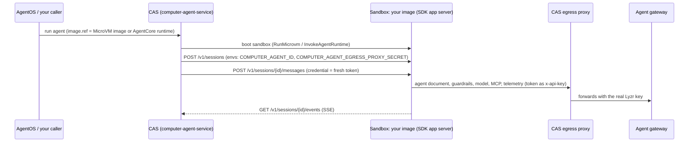

# Integrating the CAS SDK, and deploying it on AgentCore and Lambda MicroVM

This guide is for engineers who are adding the CAS SDK (`computer-agent-py`) to a system they
already run. It covers:

1. [Pick an integration mode](#1-pick-an-integration-mode): the SDK as a library inside your service,
   or the SDK's app server as a sandbox image that CAS drives.
2. [Settings](#2-settings): what goes into the image and what arrives per session.
3. [Use the SDK as a library](#3-use-the-sdk-as-a-library-in-your-own-service).
4. [Build a sandbox image](#4-build-a-sandbox-image) with the SDK's app server.
5. [Push it to ECR](#5-push-the-image-to-ecr).
6. [Register it as a Lambda MicroVM image](#6-register-a-lambda-microvm-image).
7. [Register it as an AgentCore runtime](#7-register-an-agentcore-runtime).
8. [Point an AgentOS agent at it](#8-point-an-agentos-agent-at-the-image).
9. [Troubleshooting](#9-troubleshooting).

Working examples of everything below are in `examples/sdk_default_lambda_microvm/` and
`examples/sdk_default_agentcore/`, the sources of the UAT default sandbox images (appendix). The
settings reference is [`USING_THE_SDK.md`](USING_THE_SDK.md) §3.

## How the pieces fit



The sandbox never holds a provider key, a Lyzr key or a git token. Its only secret is the
short-lived sandbox token (`sbt_…`), and every call it makes goes to the egress proxy, which swaps
the token for the real credentials. The SDK takes care of the token, including the reissued
successor the proxy sends before expiry (`USING_THE_SDK.md` §8a).

## 1. Pick an integration mode

| | A. Library in your service | B. Sandbox image driven by CAS |
|---|---|---|
| Who calls the agent | your code: `ComputerAgent(...).chat(...)` | CAS, over the harness REST API |
| What you deploy | your existing service, with the SDK as a dependency | a container image running the SDK's app server, registered as a Lambda MicroVM image or an AgentCore runtime |
| Where the token comes from | you supply it (`COMPUTER_AGENT_EGRESS_PROXY_SECRET` or `api_key=`) | CAS, per session and per message |
| Read | §2, §3 | §2, §4–§8 |

Mode B is what CAS needs for an agent's `image.ref`. Your own code does not go into the app server.
It goes into the agent itself (GAP directory, tools, MCP servers bound in AgentOS), or behind the
egress proxy.

## 2. Settings

The SDK reads every setting from a constructor argument or, when that is unset, from an environment
variable. Every missing required setting is reported in one `SettingsError`.

| Variable | Argument | Required | In a sandbox image it comes from |
|---|---|---|---|
| `COMPUTER_AGENT_ID` | `agent_id` | yes | CAS, per session (`POST /v1/sessions` `envs`) |
| `COMPUTER_AGENT_EGRESS_PROXY_SECRET` | `api_key` | yes | CAS, per session and per message. **Never bake it into an image.** |
| `COMPUTER_AGENT_ENGINE` | `engine` | yes | the image (`claude-agent-sdk` or `gitagent`) |
| `COMPUTER_AGENT_EGRESS_API_URL` | `base_url` | yes | CAS per session, or the image: `<proxy>/computer-agent-api/agentos/api` |
| `COMPUTER_AGENT_EGRESS_LLM_URL` | `llm_url` | yes | CAS per session, or the image: `<proxy>/llm` |
| `COMPUTER_AGENT_EGRESS_MCP_URL` | `mcp_url` | yes | CAS per session, or the image: `<proxy>/mcp/v1` |
| `COMPUTER_AGENT_EGRESS_GUARDRAILS_URL` | `guardrails_url` | yes | CAS per session, or the image: `<proxy>/guardrails` |
| `COMPUTER_AGENT_EGRESS_TELEMETRY_URL` | `telemetry_url` | no | CAS per session, or the image: `<proxy>/otlp` (needs the `otel` extra) |
| `COMPUTER_AGENT_EGRESS_SESSION_STORE_URL` | `session_store_url` | no | CAS per session, or the image: `<proxy>/computer-agent-api` |
| `COMPUTER_AGENT_GAP_DIR` | `gap_dir` | no | the image, when the agent is a GAP directory baked into it |

`<proxy>` is the egress proxy's base URL, e.g. `https://egress.example.com`. CAS passes the six egress
routes per session; an image that sets one in its own environment keeps it (and an agent factory's
arguments win over both), so one image works in every environment CAS runs in. The examples keep the
image's settings in a `.env` file that the Dockerfile copies next to `app.py`. Start from
`examples/*/.env.example`.

## 3. Use the SDK as a library in your own service

Install:

```bash
pip install 'computer-agent-py[agentos]'            # add [gitagent] for the gitagent engine, [otel] for telemetry
```

Run one turn:

```python
import asyncio
from computeragent import ComputerAgent, AgentResolveError

async def answer(prompt: str) -> str:
    # Construction fetches the agent document with a blocking call: keep it off the event loop.
    agent = await asyncio.to_thread(ComputerAgent)          # settings from COMPUTER_AGENT_* (§2)
    async with agent:
        result = await asyncio.wait_for(agent.chat(prompt), timeout=300)
    for message in reversed(result.messages):               # the assistant's final text
        text = getattr(message, "result", None)
        if isinstance(text, str) and text:
            return text
    return ""
```

To pass settings from your own config instead of the environment, use the arguments, which win over
the variables:

```python
agent = ComputerAgent(
    agent_id=cfg.agent_id,
    engine="claude-agent-sdk",
    base_url=f"{cfg.egress}/computer-agent-api/agentos/api",
    llm_url=f"{cfg.egress}/llm",
    mcp_url=f"{cfg.egress}/mcp/v1",
    guardrails_url=f"{cfg.egress}/guardrails",
    api_key=sandbox_token,          # or leave unset and keep it in COMPUTER_AGENT_EGRESS_PROXY_SECRET
)
```

Things to get right in a long-running service:

- **One `ComputerAgent` is one session.** Do not run two `chat()` calls on the same instance at
  once. Build one instance per conversation.
- **A turn has no timeout and nothing retries.** Wrap `chat()` in `asyncio.wait_for`.
- **The token is re-read every turn** when it comes from `COMPUTER_AGENT_EGRESS_PROXY_SECRET`. If
  your system mints a fresh sandbox token per turn, write it there before the turn. An explicit
  `api_key=` stays the key of that instance, replaced only by the proxy's own reissued successor.
- **Errors at construction** (`SettingsError`, `AgentResolveError`, `UnsupportedAgentError`) name
  the setting or field, never its value, so they are safe to log and return.

`examples/e2e/live_agent_run.py` runs one turn and prints a pass/fail line per stage. Use it to check
a new environment.

## 4. Build a sandbox image

The image runs the SDK's app server: `computeragent.server.create_app()` (or
`python -m computeragent.server`). The same process serves both runtimes:

| Runtime | Routes the platform and CAS call |
|---|---|
| Lambda MicroVM | `POST /aws/lambda-microvms/runtime/v1/{ready,validate,run,suspend,resume,terminate}`, then the harness API: `GET /v1/health`, `POST /v1/sessions`, `POST /v1/sessions/{id}/messages`, `GET /v1/sessions/{id}/events`, … |
| AgentCore | `GET /ping`, and `POST /invocations` carrying the harness API in relay envelope v1 |

The full route list is in `USING_THE_SDK.md` §14.

### 4.1 Start from an example

```bash
cp examples/sdk_default_lambda_microvm/.env.example examples/sdk_default_lambda_microvm/.env   # the engine
docker buildx build --platform linux/arm64 \
  -f examples/sdk_default_lambda_microvm/Dockerfile -t my-agent-sandbox .  # from the repository root
```

`examples/sdk_default_agentcore/` is the same app with AgentCore wording; one image works on both
runtimes. Neither bakes an egress route: CAS passes them per session (§2).

### 4.2 Or add it to your own Dockerfile

```dockerfile
FROM python:3.12-slim
RUN pip install 'computer-agent-py[agentos,server,gitagent,otel]' 'python-dotenv>=1,<2'
COPY app.py .env /app/

# The Claude CLI refuses to skip permission prompts as root; the engine runs in the working directory.
RUN useradd --create-home --uid 10001 agent && mkdir /workspace && chown agent:agent /workspace
USER agent
WORKDIR /workspace
EXPOSE 8080
CMD ["python", "/app/app.py"]
```

with `app.py`:

```python
from pathlib import Path
import uvicorn
from dotenv import load_dotenv
from computeragent.server import create_app

load_dotenv(Path(__file__).with_name(".env"), override=False)   # the image's settings (§2)
app = create_app()

if __name__ == "__main__":
    uvicorn.run(app, host="0.0.0.0", port=8080, log_level="warning", access_log=False)
```

Rules every image must follow:

- **`linux/arm64`.** Both runtimes run on Graviton.
- **Port 8080**, the only port the platforms talk to.
- **A non-root user.**
- **No secrets and no per-session values.** The image's settings are the egress routes and the
  engine. `COMPUTER_AGENT_ID` and `COMPUTER_AGENT_EGRESS_PROXY_SECRET` arrive per session. The app
  server must boot without them: a MicroVM image build runs the container to take its snapshot,
  with no session.
- **A single-platform image with Docker v2 media types.** The MicroVM build service cannot resolve
  an OCI image index (buildx's default, because of the provenance attestation):

  ```bash
  docker buildx build --platform linux/arm64 --provenance=false --sbom=false \
    --output type=image,oci-mediatypes=false,push=true \
    -f Dockerfile -t <account>.dkr.ecr.<region>.amazonaws.com/<repo>:<tag> .
  ```

### 4.3 Check it locally before you push

```bash
docker run --rm -p 8080:8080 my-agent-sandbox
curl -s -X POST localhost:8080/aws/lambda-microvms/runtime/v1/ready -o /dev/null -w '%{http_code}\n'   # 200
curl -s localhost:8080/v1/health                                                                     # {"ok":true,...}
curl -s localhost:8080/ping                                                                          # {"status":"Healthy",...}
curl -s -X POST localhost:8080/v1/sessions -H 'content-type: application/json' -d '{
  "engine": "claude-agent-sdk",
  "identity": {"loader": "gitagentprotocol", "source": {"type": "local", "path": "/agent"}},
  "envs": {"COMPUTER_AGENT_ID": "<agent id>", "COMPUTER_AGENT_EGRESS_PROXY_SECRET": "<sandbox token>"}
}'
```

With a real token, the session answers `201`. With a fake one, the answer is a `502
AGENT_BUILD_FAILED` whose detail names the proxy URL it tried, e.g.
`…/computer-agent-api/agentos/api/v1/agents/<agent id>` and `401 TOKEN_INVALID`. That error proves
the routes and the per-session values are wired.

## 5. Push the image to ECR

Use an ECR repository in the **same AWS account** as the runtime. The MicroVM build service pulls
only from public ECR or same-account ECR.

```bash
aws ecr create-repository --repository-name <team>/<agent>-sandbox \
  --image-tag-mutability MUTABLE --encryption-configuration encryptionType=KMS
aws ecr get-login-password | docker login --username AWS --password-stdin <account>.dkr.ecr.<region>.amazonaws.com
# build and push as in §4.2, then read the digest back:
aws ecr describe-images --repository-name <team>/<agent>-sandbox --image-ids imageTag=<tag> \
  --query 'imageDetails[0].imageDigest' --output text
```

Always register by digest (`<repo>@sha256:<digest>`), not by tag. A tag can move.

The role that pulls the image (the MicroVM build role, or the AgentCore execution role) needs pull
permission on your repository. Grant it in a repository policy scoped to that one role, rather than
widening the role:

```bash
aws ecr set-repository-policy --repository-name <team>/<agent>-sandbox --policy-text '{
  "Version": "2012-10-17",
  "Statement": [{
    "Sid": "PullForRuntime",
    "Effect": "Allow",
    "Principal": {"AWS": "arn:aws:iam::<account>:role/<build-or-execution-role>"},
    "Action": ["ecr:BatchGetImage", "ecr:GetDownloadUrlForLayer", "ecr:BatchCheckLayerAvailability"]
  }]
}'
```

AgentCore needs only `ecr:BatchGetImage` and `ecr:GetDownloadUrlForLayer`. Lambda MicroVM's build
role also needs `ecr:BatchCheckLayerAvailability`.

## 6. Register a Lambda MicroVM image

### 6.1 Prerequisites

| What | Requirement |
|---|---|
| Build role | trusted by `lambda.amazonaws.com`. It can read your code artifact (`s3:GetObject`) and pull your image (§5). |
| Your principal | `lambda:CreateMicrovmImage` / `lambda:UpdateMicrovmImage`, and `iam:PassRole` on the build role. Without `iam:PassRole` the call fails with `AccessDeniedException … iam:PassRole`. |
| S3 bucket | one the build role can read, for the code artifact |
| Egress | the MicroVM must reach the egress proxy. `INTERNET_EGRESS` for a public proxy; a VPC egress connector for a private one. |

### 6.2 The code artifact

The MicroVM build takes a zip with a `Dockerfile` at its root and builds it on an AWS base image.
Make it one line that names your pushed image by digest:

```bash
printf 'FROM <account>.dkr.ecr.<region>.amazonaws.com/<team>/<agent>-sandbox@sha256:<digest>\n' > Dockerfile
zip artifact.zip Dockerfile
aws s3 cp artifact.zip s3://<bucket>/<agent>-sandbox/artifact.zip
```

### 6.3 Create the image

```bash
aws lambda-microvms create-microvm-image \
  --name <agent>-sandbox \
  --base-image-arn arn:aws:lambda:<region>:aws:microvm-image:al2023-1 \
  --build-role-arn arn:aws:iam::<account>:role/<build-role> \
  --code-artifact uri=s3://<bucket>/<agent>-sandbox/artifact.zip \
  --egress-network-connectors arn:aws:lambda:<region>:aws:network-connector:aws-network-connector:INTERNET_EGRESS \
  --cpu-configurations architecture=ARM_64 \
  --resources minimumMemoryInMiB=2048 \
  --hooks 'port=8080,microvmHooks={run=ENABLED,runTimeoutInSeconds=60,resume=ENABLED,resumeTimeoutInSeconds=60,suspend=ENABLED,suspendTimeoutInSeconds=60,terminate=ENABLED,terminateTimeoutInSeconds=60},microvmImageHooks={ready=ENABLED,readyTimeoutInSeconds=600,validate=ENABLED,validateTimeoutInSeconds=600}' \
  --tags Owner=<you>,Service=<agent>-sandbox
```

| Flag | Why |
|---|---|
| `--hooks` | Enables all six lifecycle hooks on port 8080. The paths are fixed by the platform; the app server answers each with `200`. CAS sends no traffic until `run` answers. |
| `--cpu-configurations architecture=ARM_64` | The only architecture MicroVMs support |
| `--resources minimumMemoryInMiB=2048` | Baseline memory; vCPU scales with it. Raise it for heavy agents. |
| no `--environment-variables` | They are captured in the snapshot and shared by every session. Keep per-session values and secrets out. |

The call returns the image ARN and version `1.0` in state `CREATING`. Wait for the build. Pass the
**ARN**, not the name; the name gives `ValidationException: Invalid ARN format`:

```bash
aws lambda-microvms get-microvm-image-version \
  --image-identifier arn:aws:lambda:<region>:<account>:microvm-image:<agent>-sandbox \
  --image-version 1.0 --query '[state,status,stateReason]' --output text
# SUCCESSFUL  ACTIVE  None    (FAILED carries the reason)
```

### 6.4 Ship a new version

Re-pushing an ECR tag does **not** change a MicroVM image: the build took a snapshot. For every new
image, push it, point the artifact at the new digest, and build a new version:

```bash
aws lambda-microvms update-microvm-image \
  --image-identifier arn:aws:lambda:<region>:<account>:microvm-image:<agent>-sandbox \
  --code-artifact uri=s3://<bucket>/<agent>-sandbox/artifact.zip \
  --base-image-arn arn:aws:lambda:<region>:aws:microvm-image:al2023-1 \
  --build-role-arn arn:aws:iam::<account>:role/<build-role>
```

`--base-image-arn` and `--build-role-arn` are required on every update. Poll the returned version as
in §6.3. Agents pinned to an older version keep it until you move the pin (§8).

### 6.5 Limits to plan for

- A MicroVM lives at most 8 hours.
- AWS base images move from `AVAILABLE` to `DEPRECATED`, then `EXPIRING` and `EXPIRED`; an expired
  base can neither build nor run. Rebuild on a current base before then.
- Quotas: 100 images per account and region, 50 versions per image.

### 6.6 Remove it

```bash
aws lambda-microvms delete-microvm-image \
  --image-identifier arn:aws:lambda:<region>:<account>:microvm-image:<agent>-sandbox
aws s3 rm s3://<bucket>/<agent>-sandbox/artifact.zip
```

## 7. Register an AgentCore runtime

### 7.1 Prerequisites

| What | Requirement |
|---|---|
| Execution role | trusted by `bedrock-agentcore.amazonaws.com`. It can pull your image (§5) and write logs to `/aws/bedrock-agentcore/runtimes/*`. |
| Your principal | `bedrock-agentcore:CreateAgentRuntime` / `UpdateAgentRuntime`, and `iam:PassRole` on the execution role |
| Network | `PUBLIC` reaches a public egress proxy. For a private proxy use `VPC` with your subnets and security groups. |

### 7.2 Create the runtime

```bash
aws bedrock-agentcore-control create-agent-runtime \
  --agent-runtime-name <agent>_sandbox \
  --agent-runtime-artifact 'containerConfiguration={containerUri=<account>.dkr.ecr.<region>.amazonaws.com/<team>/<agent>-sandbox@sha256:<digest>}' \
  --role-arn arn:aws:iam::<account>:role/<execution-role> \
  --network-configuration networkMode=PUBLIC \
  --protocol-configuration serverProtocol=HTTP \
  --tags Owner=<you>,Service=<agent>-sandbox
```

The name allows letters, digits and `_` only, starting with a letter. The answer carries the runtime
ARN, `arn:aws:bedrock-agentcore:<region>:<account>:runtime/<agent>_sandbox-<10 chars>`. Wait for
`READY`:

```bash
aws bedrock-agentcore-control get-agent-runtime --agent-runtime-id <agent>_sandbox-<10 chars> \
  --query '[status,failureReason,agentRuntimeVersion]' --output text
```

Leave `--environment-variables` unset, for the same reason as on MicroVM: the values are shared by
every session.

### 7.3 Ship a new version

`update-agent-runtime` with the new digest (and the same role, network and protocol) creates a new
immutable runtime version. The `DEFAULT` endpoint follows the latest version. Create a named
endpoint (`create-agent-runtime-endpoint`) if you want to move agents explicitly.

### 7.4 Remove it

```bash
aws bedrock-agentcore-control delete-agent-runtime --agent-runtime-id <agent>_sandbox-<10 chars>
```

## 8. Point an AgentOS agent at the image

An agent's `image` tells CAS what to boot for it. `ref` must be a MicroVM image ARN
(`arn:aws:lambda:…:microvm-image:…`) or an AgentCore runtime ARN
(`arn:aws:bedrock-agentcore:…:runtime/…`). An ECR image URI is refused.

```bash
# Lambda MicroVM: version pins an image version; omit it for the latest active one.
curl -s -X PATCH "<agentos>/agentos/api/v1/agents/<agent id>" \
  -H "x-api-key: <your Lyzr key>" -H 'content-type: application/json' \
  -d '{"image": {"runtime": "lambda-microvm", "ref": "arn:aws:lambda:<region>:<account>:microvm-image:<agent>-sandbox", "version": "1.0"}}'

# AgentCore: version is the endpoint (qualifier); omit it for CAS's default (DEFAULT).
curl -s -X PATCH "<agentos>/agentos/api/v1/agents/<agent id>" \
  -H "x-api-key: <your Lyzr key>" -H 'content-type: application/json' \
  -d '{"image": {"runtime": "agentcore", "ref": "arn:aws:bedrock-agentcore:<region>:<account>:runtime/<agent>_sandbox-<10 chars>"}}'
```

`"image": null` clears it. The change applies to the next new sandbox. The agent's own definition
(model, MCP servers, guardrails) stays in AgentOS; the image only decides where it runs.

CAS itself must be allowed to use the resource: `lambda:RunMicrovm` on the MicroVM image, or
`bedrock-agentcore:InvokeAgentRuntime` on the runtime. This is part of CAS's own IAM. An
`AccessDenied` at boot surfaces as `MICROVM_AGENT_IMAGE_*` or `AGENTCORE_AGENT_RUNTIME_ACCESS_DENIED`.

### What CAS sends your image

| When | Request | What the app server does |
|---|---|---|
| Boot (MicroVM) | lifecycle hooks | answers `200` |
| Session start | `POST /v1/sessions` with `envs.COMPUTER_AGENT_ID`, `envs.COMPUTER_AGENT_EGRESS_PROXY_SECRET` and the six `envs.COMPUTER_AGENT_EGRESS_*_URL` | builds the session's `ComputerAgent` for that agent, with that token, on those routes (an egress route the image sets itself wins); every other `envs` key is ignored |
| Each turn | `POST /v1/sessions/{id}/messages` with `credential` | uses the fresh token for the turn |
| Streaming | `GET /v1/sessions/{id}/events` | the turn's events; one `ca_session_ended` when the session ends |
| AgentCore | the same requests inside `POST /invocations` (relay envelope v1) | answers HTTP 200 always; the real status is in the envelope |

## 9. Troubleshooting

| Symptom | Cause | Fix |
|---|---|---|
| MicroVM version `FAILED`: "An unknown error occurred" | The pushed image is an OCI index or uses OCI media types | Push with `--provenance=false --sbom=false --output type=image,oci-mediatypes=false,push=true` (§4.2) |
| MicroVM version `FAILED` on the pull | The build role cannot pull from your repository | Repository policy for the build role (§5) |
| `AccessDeniedException … iam:PassRole` on create | Your principal cannot pass the build or execution role | Grant `iam:PassRole` on that role only |
| `ValidationException: Invalid ARN format` on `get-microvm-image-version` | The image name was passed | Pass the image ARN |
| MicroVM build hangs at `ready`, or the container exits at start | The app requires a per-session value at boot | Read `COMPUTER_AGENT_ID` and the token per session; the app server does |
| Agent registration: `IMAGE_REF_INVALID` / `AGENTCORE_RUNTIME_ARN_INVALID` | `ref` is an ECR URI or a malformed ARN | Register the MicroVM image ARN or the AgentCore runtime ARN (§8) |
| Session start: `502 AGENT_BUILD_FAILED … 401 TOKEN_INVALID` | The token is not a valid sandbox token for this proxy, or it expired | CAS mints it; for a manual test, mint one at the proxy |
| Session start: `502 AGENT_BUILD_FAILED … SettingsError: missing required settings: …` | The image lacks an egress route or the engine | Set them in the image's `.env` (§2) |
| A pushed fix does not show up on MicroVM | MicroVM images are snapshots | `update-microvm-image` (§6.4) and move the agent's `version` pin |

## Appendix: the UAT default sandboxes

UAT CAS boots these when an agent names no image of its own (`LAMBDA_MICROVM_IMAGE_ARN` and
`AGENTCORE_RUNTIME_ARN` on `computeragent-server`). They are built from
`examples/sdk_default_lambda_microvm/` and `examples/sdk_default_agentcore/`, bake no egress route
(CAS passes them per session), and are managed by Terraform in `lyzr-studio-infra`
(`infrastructure/serverless/lambda-microvm/sdk-default.tf`, `infrastructure/ecr`). Account
`425642439121`, `us-east-1`.

| Runtime | Resource | Image |
|---|---|---|
| Lambda MicroVM | `arn:aws:lambda:us-east-1:425642439121:microvm-image:lyzr-studio-uat-computeragent-sdk-default`, version `1.0` | `computer-agent/sdk-default-lambda-microvm@sha256:a8a1f7288d87609f46040d18202e6a886a71142b88094f996f1d4301dc023cf4` |
| AgentCore | `arn:aws:bedrock-agentcore:us-east-1:425642439121:runtime/lyzr_studio_uat_computeragent_sdk_default-wzY4Av5AO0`, version `1` (endpoint `DEFAULT`) | `computer-agent/sdk-default-agentcore@sha256:36366184d84e2f3bd36de74549e7e60c110e958e72352feb9dce23febb994aff` |
